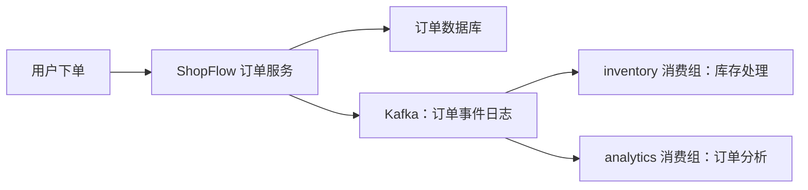
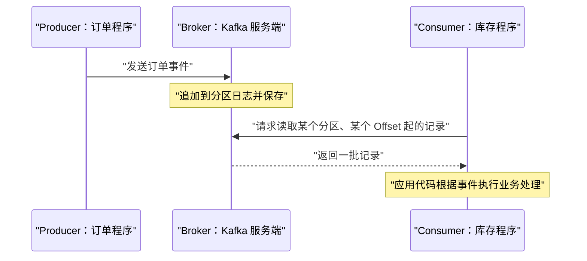

# 第 1 章：Kafka 到底解决什么问题

> 从同步调用，到可重放的事件日志。贯穿案例：ShopFlow 订单系统。

## 【积木 1】先带着问题来：订单服务为什么越来越难改？

假设你正在开发 ShopFlow。用户下单后，系统需要记录订单、扣减库存，还要把订单信息送给数据分析系统。最直接的写法是什么？订单服务依次调用库存服务和分析服务，全部完成后再向用户返回结果。

一开始，这很合理。后来新增通知、推荐、积分功能，订单服务就又多了几个调用。某个下游响应变慢，下单接口也跟着变慢；分析服务维护，本来能创建的订单却可能报错。你只是增加一个观察订单数据的功能，却要修改下单主流程。

这一章不先背参数，而是回答三个问题：

1. 同步调用什么时候变成耦合，Kafka 能拆开什么？
2. 为什么把 Kafka 理解成“消费后就消失的队列”容易出错？
3. 两个业务怎样独立读取同一批订单事件，并且重新读取历史？

读完后，你应该能画出 ShopFlow 的事件流，解释分区与位置，并在本地亲眼验证“独立消费”和“重放”。暂时不要求理解集群选举、提交位置或消息事务。

## 【积木 2】同步调用的问题，不只是“速度慢”

先区分两类需求。支付页面可能必须立即知道支付是否成功，这是用户正在等待的结果；分析系统统计今日订单数，通常不必阻塞用户下单。不是所有调用都应该异步，也不是装上 Kafka 就能取消所有同步依赖。

同步链路常见的困难有三类：

- **可用性耦合**：下游故障会沿调用链影响上游。
- **变化耦合**：每多一个下游，上游就要知道它并修改调用逻辑。
- **节奏耦合**：订单高峰瞬间涌入，慢下游没有自己的缓冲和追赶空间。

换个组织方式：订单服务记录业务事实，再把事件写入 Kafka。库存系统和分析系统各自读取。分析暂时停机，不要求订单服务等它；恢复后，它可以从仍然保留的历史中追赶。



这张图表示目标架构，不代表数据库与 Kafka 已经实现原子写入。异步也有代价：库存和报表可能稍后才更新，系统需要面对失败重试、重复处理和监控。若业务要求“库存不足就绝不能创建订单”，仍要设计预占库存或其他一致性流程，不能只把扣库存移到后台就宣布问题解决了。

## 【积木 3】事件与命令：先弄清楚你在表达什么

**命令**是“请做某件事”，例如 `reserve.inventory`：请为订单预留库存。它通常有明确的执行对象，可能被接受，也可能被拒绝。

**事件**是“某件事已经发生”，例如 `order.created`：订单已经创建。它描述过去的事实，可以被多个系统观察。订单服务不必知道将来会有多少观察者。

ShopFlow 可以使用这样的事件：

```json
{"event_id":"evt-001","event_type":"order.created","order_id":"order-1001"}
```

`event_id` 用来标识这次事件，`order_id` 指向业务订单，二者不是一个概念。真实业务还会补充发生时间、商品明细、模式版本等字段；本章保留最少字段，先观察日志行为。

实验会发送 `order.created`、`order.paid`、`order.cancelled` 三条 JSON，且 `order_id` 各不相同。它们只是三条演示记录，**不是同一个订单按创建、支付、取消顺序完成的生命周期**。库存消费者需要根据事件类型决定动作，不能把每条订单事件都理解成“扣一次库存”。

Kafka 不会自动判断 JSON 是否符合业务规则，也不会把事件变成正确的业务动作。事件表达、校验与处理仍是应用的责任。

## 【积木 4】核心心智模型：一份追加日志，多个独立读者

先把 Kafka 想成按顺序追加的记录本，而不是阅后即焚的信箱。写入新记录时，它被追加到日志末尾；读者翻到某页，不会把那页撕掉。

认识第一批术语：

| 术语 | 中文理解 | 在 ShopFlow 中的对应 |
| --- | --- | --- |
| Producer | 生产者，向 Kafka 写记录的客户端 | 订单服务或实验中的发送工具 |
| Broker | Kafka 服务端进程，接收、存储并提供记录读取 | 本地运行的 Kafka 服务，不等同于物理机器 |
| Topic | 主题，一类记录的逻辑集合 | 订单事件主题 |
| Partition | 分区，主题内部的一条有序日志 | 本章主题唯一的日志分区 |
| Offset | 偏移量，记录在某个分区内的位置 | 分区 0 中的 0、1、2 |
| Consumer | 消费者，读取记录的客户端 | 库存或分析程序 |
| Consumer Group | 消费组，一组协作读取主题的消费者 | `inventory` 与 `analytics` |
| Controller | 控制器，管理集群元数据与协调工作 | 本地 KRaft 的控制角色 |

### 一个高频误解：Broker 是机器，Consumer 也是 Kafka 服务器吗？

可以先把 Broker 理解成“运行 Kafka、保存消息并提供读写服务的节点”。但严格说，**Broker 是 Kafka 服务端进程或服务实例，不是物理机器本身**。它可以运行在物理机、虚拟机或容器中；本课程就是在你的电脑上用容器运行一个 Kafka 实例，它同时承担 Broker 与 Controller 角色。

“机器、程序、数据”分开看就清楚了：机器提供 CPU、内存与磁盘，Broker 程序在机器或容器里运行，消息日志存放在它配置的存储位置。生产中常让不同 Broker 分散在不同机器上，但不要把“几个 Broker”直接等同于“几台物理服务器”。

Consumer 则是使用 Kafka 的**客户端程序或客户端实例**，例如库存服务中的 Kafka 读取代码、Python 分析程序，或实验里的 `kafka-console-consumer.sh`。它不是另一台 Kafka Broker，也不需要和 Broker 部署在同一台机器上。业务服务能对外提供 HTTP 接口，同时在内部运行 Kafka Consumer；“服务端/客户端”是相对于这一次通信而言，不是程序永远只有一种身份。



这个时序强调：**Consumer 主动向 Broker 请求数据，Broker 返回记录**。正常消费是持续发起读取请求（可能等待新记录、批量返回），不是消费者直接打开 Broker 的磁盘文件，更不是 Broker 自动帮它执行库存业务。名字中的“消费”表示读取并使用消息，不表示把原消息吃掉或删除。

拿 ShopFlow 举例：订单程序是 Producer，发布 `order.created`；Broker 保存事件；库存程序里的 Consumer 读到事件，应用代码再做相应处理。Broker 不知道怎样正确扣库存，Consumer 读取成功也不等于扣库存成功。本章的两个 CLI 消费者只是打印记录，还没有真实业务处理。

你问“Broker 是不是存储 Topic 数据的机器”：**作为入门直觉可以，但准确说是负责存储该 Topic 某些分区副本并提供读写服务的 Kafka 实例。**Topic 是逻辑分类，真正保存的是 Partition 的日志与索引。同一 Broker 可以存储多个 Topic 的分区副本；一个 Topic 的分区副本也可以分散在多个 Broker 上，不是“一台 Broker 专门保存一个完整 Topic”。本章只有一个 Broker，所以本章实验 Topic 的唯一分区就在这个节点上。

### 一个高频误解：Topic 是在分区里面吗？为什么需要分区？

层级反过来：**一个 Topic 包含一个或多个 Partition，每个 Partition 是一条独立的有序日志。**Topic 是“订单事件”这个逻辑集合；分区是它实际收纳消息、分配工作时的单位。不是一个 Topic 放进了若干外部分区，也不是分区等于一台机器。

假设 `orders` Topic 有三个分区，六条订单事件被分配成这样（仅为示意，不代表默认轮询算法）：

```text
orders Topic
├── Partition 0：订单 A（offset 0）→ 订单 D（offset 1）
├── Partition 1：订单 B（offset 0）→ 订单 E（offset 1）
└── Partition 2：订单 C（offset 0）→ 订单 F（offset 1）
```

它们合起来仍是一个订单 Topic。一次发布的记录会进入其中一个分区，不会因为有三个分区就自动复制到三个分区；失败重试可能引入重复是另一个问题。**分区是拆分，副本是对同一分区复制**，后者在第 8 章讲。

为什么拆？可以类比超市增加收银通道，但别把分区数量直接理解成机器数量。

1. **让数据与读写负载可以分散。**只有一条分区日志时，常规写入集中到这一个分区的 Leader。如果有多条分区，它们的 Leader 可以分布在多个 Broker 上，让多台机器共同承担一个 Topic 的负载与存储。多个分区也可以都在一个 Broker 上；只增加分区，不增加资源或解决瓶颈，不保证性能提升。
2. **让同一个消费组并行分工。**在本课程常规 Consumer Group 订阅模式下，同一分区在同一时刻分配给组内一个 Consumer。一个分区、三个消费者时，最多一个获得这个 Topic 的分区；三个分区、三个消费者时，可以每人负责一个，分别处理不同记录。一个 Consumer 也可以负责多个分区。这个 Topic 对单个普通消费组的分区分配并行度受分区数限制，不代表应用内部永远不能开工作线程。
3. **在需要的范围内保持顺序。**不同订单往往可以并行处理，同一订单的创建、支付等事件则可能需要先后关系。可以用 `order_id` 作为消息 key，在分区数量与分区策略稳定且一致时，将同一 key 路由到同一分区；生产者还必须按需要的业务顺序发布，消费者应用也要避免处理乱序。Kafka 的日志顺序不是跨分区全局时间线，也不会自动纠正事件的业务先后。第 3、4 章再做实验。

拆分的代价也要知道：你得到并行能力，却不再有整个 Topic 的统一顺序；分区越多，元数据、文件和管理开销也会增加，所以不是越多越好。若数据量小、业务确实需要一条统一日志，可以只创建一个分区，这也是第 1 章实验的做法。

现在记住三层关系即可：**Topic 是消息类别，Partition 是类别里面的日志分片，Broker 是保存分片并提供服务的 Kafka 实例。**分片的副本可以分布在 Broker 上，但三者不是一一对应。

Topic 可以有多个 Partition。**Offset 只在所属分区中有意义，不是订单 ID，也不是整个主题的全局流水号。**定位一条记录需要同时知道主题、分区和 Offset。生产环境日志经过清理后，Offset 还可能存在空缺；不必把它当成业务计数器。

Kafka 保证的是**分区内的记录顺序**，不是所有分区合起来的全局顺序。消费者即使顺序读到记录，应用若并行处理，完成顺序也可能不同。本章只用一个分区，便于看清追加顺序；后续再研究业务 Key 如何影响分区选择。

还有两条边界要记牢：

- 消费者读取不会删除日志，但保留策略会清理历史，例如到达时间或容量限制后删除旧日志段。因此 Kafka **不是永久数据库**，也不保证任何时候都能重放全部历史。
- Producer 的 `acks` 是发送确认配置。收到写入确认，不等于库存已经扣减、分析已经入库；确认强度与副本配置还会影响写入保障，不能把本章单副本环境当成高可用方案。

### 一个高频误解：消息读完就删吗？谁决定什么时候删？

**Consumer 读取不会删除记录，提交消费 Offset 也不会删除记录。**读取是翻记录本，提交位置是保存书签；清理则由 Broker 按 Topic 的清理策略执行。普通消费组“读完了没有”不决定日志该不该删：全部组读完，未到清理条件仍可保留；某个组没读完，到清理条件也可能删除。

每个 Partition 的日志不是一份无限增长的大文件，而是由多个 **Segment（日志段）**组成，像一本记录本被拆成若干册。主要有两类清理策略：

| Topic 参数 | 做什么 | 适用心智模型 |
| --- | --- | --- |
| `cleanup.policy=delete` | 根据时间或容量淘汰旧日志段 | 保留一段时间的完整事件历史 |
| `cleanup.policy=compact` | 后台按 Kafka key 清理被更新覆盖的旧版本，保留各 key 的最新状态 | 用事件更新构建状态，而非永久保留完整过程 |
| `cleanup.policy=delete,compact` | 对保留的数据做 compact，也按时间/容量淘汰旧段 | 最新状态也仍有保留边界 |

默认 `delete` 下，两个常用 Topic 参数是 `retention.ms`（保留时长，毫秒）和 `retention.bytes`（每个分区的保留容量，字节）。二者都设置时，达到时间或容量任一条件就可能触发清理，不是必须两者同时满足。容量限制按分区计算，不是整个 Topic 共用一个数，也不是精确硬磁盘配额。

本课程 Compose 设置了 `KAFKA_LOG_RETENTION_HOURS=168`，即 Broker 的默认时间保留窗口为七天，Topic 可以覆盖默认值。**七天从记录/日志段的时间判断，不从消费完成时重新计时。**这不是“每条消息满七天的那一秒立即消失”：后台检查、日志段内的时间条件、段切换与文件删除延迟都会影响实际清理时刻。主要按日志段批量淘汰，不是某个消费者读到一条就删一条。Kafka 4.3 的时间保留条件本身也可以触发段滚动，不要误记成“当前段不写满就永远不能清理”。这些细节在第 9 章实战。

例如订单事件已写入并保存，库存组今天读完、分析组暂时停机：

```text
消费/提交：只推进各自进度，事件仍在
保留条件尚未到：分析组恢复后仍可读取历史
保留条件到达并执行清理：旧历史可能消失，即使分析组从未读取
```

如果分析组需要的 Offset 已落在最早保留位置之前，客户端会根据其 Offset 重置配置或错误处理逻辑决定接下来怎么办。`earliest` 也只能读到“目前还在的最早记录”，不能找回已经删除的旧事件。要保住需要追赶或重放的数据，应结合最大停机时间、积压量、容量上限设计保留窗口，必要时另外归档，而不是指望 Kafka 等所有消费者确认后才删。

`compact` 又是另一种语义。例如同一分区里 `key=order-1001` 先有 value“已创建”，后有 value“已支付”，后台清理可以去掉被覆盖的旧状态，保留最后状态。它不是按 JSON 的 `order_id` 自动去重，也不意味着发送新状态后旧状态瞬间消失；还没清理时消费者可能读到多个版本。带 key、value 为真正 null 的记录是 **tombstone（删除标记）**，用于删除该 key 的状态，标记经过相应保留和清理流程后也可以被移除。它不是字符串 `"null"`。

纯 `compact` 不采用 `delete` 的时间/容量规则去淘汰普通日志段，不能把七天理解为所有最新 key 值必被删；启用 `delete,compact` 时则同时有时间/容量淘汰。Log Compaction 与第 4 章的 gzip 字节压缩不是一回事，也不是保证业务副作用只发生一次的机制。订单全生命周期事件 Topic 若需要重放创建、支付、发货的完整过程，不能不评估就用订单 ID 做 key 并启用 compact。

此外，管理员可以显式删除 Topic 或截断历史，这不是消费触发的自动清理。本次只解释和补充讲义，不修改 Topic 清理参数，不删除任何实验数据。

参考：[Kafka 4.3 Topic 清理与保留配置](https://kafka.apache.org/43/configuration/topic-configs/)。第 9 章再展开日志段、delete/compact 与磁盘实战；现在记住：**消费者管读取进度，Broker 按保留策略管日志清理，二者独立。**

## 【积木 5】两个消费组，为什么都能读到完整事件流？

假设分区 0 现在有三条记录：

```text
Offset 0 → order.created   / order-1001
Offset 1 → order.paid      / order-1002
Offset 2 → order.cancelled / order-1003
```

`inventory` 需要处理库存相关业务，`analytics` 需要统计订单。它们属于两个独立消费组，因此各自读取同一份事件流，彼此不抢记录。只要读取范围相同且历史仍在，两个组都能看到上述三条记录。

**同组是分工，不同组是独立订阅。**在常规消费组订阅模式下，一个分区同一时刻分配给组内一个消费者。本章只有一个分区，所以同一个组即使启动两个消费者，也不会让这一个分区同时交给两人分摊。第 5 章会正式研究组内分工。

消费者有读取位置，也可以提交位置，帮助后续从合适的地方继续。读取、业务处理、提交是不同动作。本章先不验证提交机制，也不根据工具跑完就声称“业务处理与 Offset 提交可靠完成”；第 6 章会单独拆解。

重放则是重新读取保留中的历史。本章使用明确的分区和 Offset 直接读取，不修改任何消费组的已提交位置。将来重放生产数据时，还必须考虑业务副作用：同一条库存事件处理两次，不能真的扣两次库存。

## 【积木 6】实战：亲眼看见独立消费与重放

配置文件在 [单节点 Compose](../infra/single-node/compose.yaml)，完整步骤与脚本说明见 [第 1 章实验手册](../labs/ch01-hello-kafka/README.md)。下面两条命令都在**仓库根目录**执行。

```bash
docker compose -f infra/single-node/compose.yaml up -d --wait
```

**目的**：按照指定文件启动单节点 Kafka，并等待 Compose 配置的健康检查通过。**预期现象**：命令成功返回，Kafka 容器健康。实验使用 `apache/kafka:4.3.1`，采用 KRaft；容器内部访问 `kafka:9092`，宿主机访问 `127.0.0.1:19092`。这两个地址对应不同网络视角，不要随意互换。

```bash
bash labs/ch01-hello-kafka/verify.sh
```

**目的**：自动完成一次隔离的入门验证。**预期现象**：脚本创建唯一主题 `shopflow.orders.ch01.<runid>`，配置为一个分区、一个副本；发送三条 JSON 事件；独立的 `inventory` 与 `analytics` 消费组各从头读到三条；再直接从分区 0、Offset 0 重放三条。

脚本使用独立组名隔离每次运行，具体名字以输出为准。`--from-beginning` 的意思是：当组没有可用的已提交位置时，从当前保留历史的开头读取；它**不会强制把已有组倒回开头**。本章的直接重放使用 `--partition 0 --offset 0`，不进行消费组重置，也不以此演示 Offset 提交。

**验收标准**：

1. 能找到本次唯一主题，确认只有一个分区、一个副本。
2. 两个独立组各读到三条，事件类型与不同订单 ID 正确。
3. 直接重放仍读到三条，说明前面的读取没有删除记录。
4. 能解释为何它们是“同一份日志、三次读取”，而不是发送了九条消息。

**加练**：沿用本次主题，通过实验手册中的发送方式新增第四条 JSON，使用新的 `event_id` 和 `order_id`；再选择一个从未使用的新消费组从头消费。预期读到四条，新增记录处于分区末尾。不要用已消费组配合 `--from-beginning` 来冒充全量重放。

启动失败时先检查 Docker daemon 是否运行；端口冲突时查看 `19092` 是否被占用；镜像拉取失败时检查镜像仓库连通性与 Docker 代理配置。详细排查见实验手册。不要默认执行 `docker compose down -v`，它会删除卷数据。单副本与 `PLAINTEXT` 明文连接仅用于本地教学，不是生产配置。

## 【积木 7】别把“解耦”误读成“问题全消失了”

回看架构图，订单数据库写成功，发送 Kafka 消息却失败，会怎样？数据库里已经有订单，库存和分析却没有收到对应事件。反过来，先发事件再写数据库，也可能留下“事件存在、订单不存在”的不一致。

简单重试不能自动把两套系统的写入变成一个原子操作，还可能产生重复事件。第 11 章会用 **Outbox（事务发件箱）**把待发事件与业务数据一起写入本地数据库事务，再讨论可靠投递与 **CDC（变更数据捕获）**。现在先识别这个缺口，不要假设“用了 Kafka 就解决双写”。

**本章小结**：Kafka 用可保留、可重读的分区日志，让不同业务按自己的节奏观察事件。它降低同步依赖，却要求应用认真面对延迟、重复、保留边界与一致性。你应记住：事件是事实；消费不删除日志；位置属于分区；顺序只在分区内；发送确认不是下游成功。

## 【积木 8】自测与下一章

先不看答案，用自己的话回答：

1. `analytics` 消费组三条都读完，为什么 `inventory` 仍能读取这三条？
2. 分区 0 的 Offset 2 与分区 1 的 Offset 2，是同一条订单事件吗？
3. Producer 收到写入确认，能否向用户承诺库存处理成功？
4. 一个已有消费组加上 `--from-beginning`，一定会重新读取全部历史吗？
5. 订单入库成功、发送消息失败，会丢失什么业务事实的传播？课程在哪里解决？
6. Broker 是物理机器还是服务进程？Consumer 是 Kafka 服务端的一部分吗？谁发起读取请求，谁负责扣库存？一个 Topic 必须完整放在同一个 Broker 上吗？
7. Topic 与 Partition 谁包含谁？三个分区意味着每条消息存三遍吗？一个分区、三个同组消费者，会自动三人分摊吗？分区为什么可以提高并行能力，又牺牲了哪种顺序？
8. 所有组都读完并提交，消息会立刻删除吗？某组没读完能阻止保留清理吗？delete 与 compact 有什么区别，earliest 能恢复已删历史吗？

<details>
<summary>展开参考答案</summary>

1. 两个组独立读取同一份日志。读取不会删除记录；前提是记录尚未被保留策略清理。
2. 不是。Offset 是分区内位置，必须结合主题与分区定位，不能替代 `order_id`。
3. 不能。确认描述 Kafka 写入这一侧的结果，不代表任何下游业务已经完成。
4. 不一定。有可用的已提交位置时通常从该位置继续；且“开头”仅指仍保留的历史。本章用新组验证从头读取，用指定分区与位置验证直接重放。
5. 数据库中的订单事实没有可靠传播到下游。第 11 章通过 Outbox/CDC 讨论可靠事件发布，同时还需要下游做好重复处理防护。
6. Broker 是运行于机器或容器中的 Kafka 服务端进程/实例；Consumer 是连接它的客户端，通常在业务程序中。Consumer 发起读取，Broker 返回记录，库存应用负责业务动作。Topic 的分区副本可以分散到多个 Broker 上，一个 Broker 也可以保存多个 Topic 的分区副本。
7. Topic 包含一个或多个 Partition；分区拆分消息，不是复制整份消息。普通同组订阅时，一个分区同一时刻只分配给一个消费者，不会因启动三个就自动三人分摊。多个分区的 Leader 可以分散到 Broker 上，同组消费者也可以分别负责不同分区，因此提供存储与处理分工；代价是只有分区内顺序，没有 Topic 级跨分区全局顺序。
8. 都不会。读取/提交与日志清理独立；delete 按时间或每分区容量淘汰旧段，compact 按 key 清理旧状态且不是即时去重。earliest 只能从仍保留的最早位置读取，不能恢复已删历史。

</details>

**下一章：KRaft 与本地环境。**我们会拆开这个已运行的单节点环境，理解 Broker 与 Controller 为什么是不同角色、KRaft 管理什么，以及 `listeners` 和 `advertised.listeners` 为何会导致“容器能连，宿主机不能连”。先让环境变得可解释，再在第 3 章深入 Topic、Partition 与 Offset。

*学完本章并完成实验，回到对话说“继续”，我们再进入第 2 章。*
