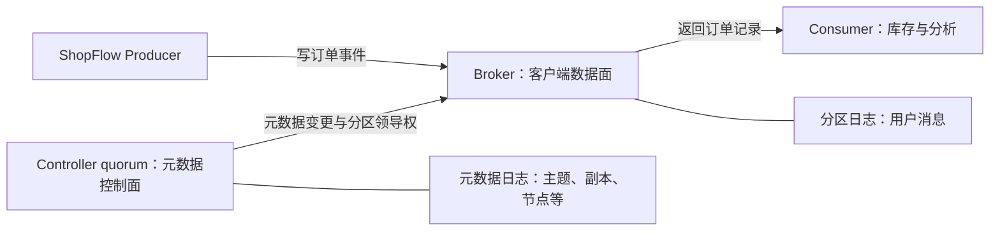
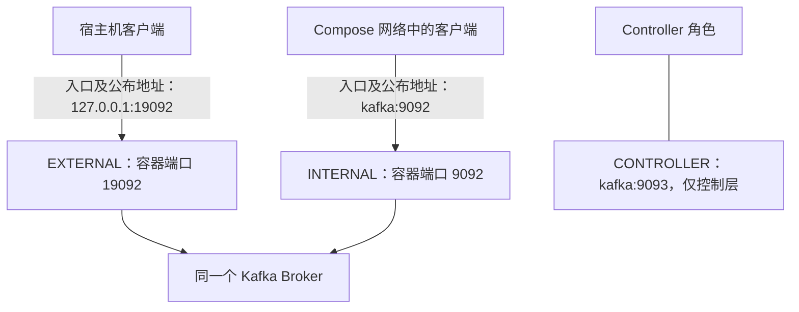

# 第 2 章：KRaft 与本地环境——让“能启动”变成“能解释”

> 贯穿案例：ShopFlow 订单系统。上一章看见订单日志，这一章拆开支撑它的进程、网络和磁盘。

## 【积木 2-1】导读：先问清楚，订单到底交给谁？

在[第 1 章](01-why-kafka.md)，我们运行了单节点 Kafka。你可能看见配置里同时写着 `broker,controller`，也可能发现容器里的地址和宿主机地址不一样。不要先把它们背成口诀，我们从一条订单的旅程开始。

本章学习目标：

1. 区分 Broker 与 Controller，解释两种 Leader 为什么不是同一回事。
2. 说清 KRaft 复制的是哪类信息，以及多数派为什么不能替代消息副本。
3. 根据客户端所在网络选择入口，理解“端口能通但读写失败”。
4. 通过保留卷的容器重建实验，验证身份、元数据和订单记录仍在，并说明验证边界。

实验沿用[单节点 Compose](../infra/single-node/compose.yaml)，镜像为 `apache/kafka:4.3.1`。本章不增加生产集群，不要求现在理解完整 Raft 算法；先建立正确的分工图。

## 【积木 2-2】Broker 管订单日志，Controller 管集群目录

把 Broker 想成仓库柜台：生产者把订单事件交给它，它写入分区日志；消费者向它请求记录，它返回数据。Broker 是客户端读写记录的数据面入口。

Controller 更像维护仓库目录的调度员：集群有哪些 Broker，主题有哪些分区，副本放在哪里，哪个副本担任分区 Leader？这些是**集群元数据**。活跃 Controller 领导者根据状态和规则管理元数据、决定分区 Leader，相关变更再传播给 Broker。



图中的两类日志不能混为一谈。Controller 不负责替 Broker 接收、存储、转发每一条订单。生产者也不应把 Controller 端口当成订单发送入口。

还有两个容易混淆的名字：

- **Controller Leader**：控制器仲裁组中当前活跃的领导者，负责组织元数据变更。
- **Partition Leader**：某一个分区的领导副本，位于 Broker 上，处理该分区的常规读写。

一个集群有多个分区，就可能有多个分区 Leader，分布在不同 Broker 上。它们与 Controller Leader 不是同一套领导权。即便本地二者恰好都涉及节点 `1`，也只是角色合在同一个节点，不是概念相同。

## 【积木 2-3】KRaft 的多数派，保住的是元数据共识

KRaft 使用 Raft 控制器仲裁组复制元数据日志。你可以先这样理解：关于集群目录的变更，不能靠某台机器单方面宣布并永久生效，要经过仲裁组的共识流程；领导者失效后，还需要有足够成员完成新的选举与推进。

多数派需要 `floor(n/2) + 1` 个投票成员。生产中常见 `3` 或 `5` 个 Controller：

| 投票 Controller 数 | 多数派数量 | 维持多数派最多容忍失效数 |
| --- | --- | --- |
| 1 | 1 | 0 |
| 3 | 2 | 1 |
| 5 | 3 | 2 |

一般最多容忍 `floor((n-1)/2)` 个成员失效。这个结论还隐含剩余成员能够互通等条件，网络分区时不能只数“进程还活着”。失去多数派会影响控制面推进，不能把“还有 Broker 进程”理解成集群可以无限正常运行。

**Raft 元数据复制，不是用户消息副本的 ISR 复制算法。**三台 Controller 不会自动让每条订单变成三副本。用户消息副本、ISR 与写入确认将在第 8 章展开；今天只把两类复制明确分开。

本实验 `KAFKA_PROCESS_ROLES=broker,controller`，属于 combined 模式：**一个 Kafka 进程，承担两个职责**。它只有一个投票 Controller，也只有一个 Broker；节点退出，两类职责一起消失，所以不具备高可用。

`KAFKA_CONTROLLER_QUORUM_VOTERS=1@kafka:9093` 表示当前静态配置中的投票成员：节点 `1`，控制器地址 `kafka:9093`。这是本课程的 static quorum 学习配置，不能当成所有动态 quorum 部署的普遍模板。静态与动态成员管理有不同的配置和初始化流程；不要仅凭这一行去扩建生产集群。

## 【积木 2-4】两张身份证，与一块不能随便清空的磁盘

`cluster.id` 是集群身份证，`node.id` 是节点身份证。两台属于同一集群的节点共享集群身份，却不能使用相同节点身份。

Compose 中固定的 `CLUSTER_ID` 是 `MkU3OEVBNTcwNTJENDM2Qk`，`KAFKA_NODE_ID` 是 `1`。前者由镜像启动流程用于存储初始化，后者对应 Kafka 的 `node.id`。首次初始化后的存储身份信息会写入 `meta.properties`，不是每次启动都随便抽签。

想象仓库的货架上已经贴着集群甲、节点一的标签，却把进程改成集群乙、节点二：磁盘与配置对不上，不能指望 Kafka 把旧数据自动解释成新集群。**旧卷存在时，不要随意改身份，也不要用重新格式化来掩盖身份不一致。**先确认配置与存储的归属，再决定是否需要一个真正全新的实验环境。

本配置 `KAFKA_LOG_DIRS=/var/lib/kafka/data`，命名卷 `kafka-data` 挂载到这个目录。未单独指定 `metadata.log.dir` 时，元数据日志默认使用首个 `log.dirs` 目录。因此这里的卷同时保留：

- 用户主题的分区数据；
- KRaft 元数据日志；
- `meta.properties` 等存储身份信息。

所以，保留的不是“仅有订单文件”。如果只想到消息目录而忽视元数据和身份，恢复时就容易拿到零件，却拼不回原来的集群。

## 【积木 2-5】监听地址与公布地址：门开在哪里，导航写什么？

`listeners` 表示服务绑定的本地网卡和端口；`advertised.listeners` 表示告诉客户端后续使用什么地址。直觉上，一个是“柜台开在哪里”，另一个是“发给客户的导航”。柜台开了，但导航写成客户到不了的位置，照样办不了业务。

客户端的 `bootstrap-server` 只是取得集群元数据的入口。正常过程是：先连接入口，拿到 Broker 与分区领导者等元数据，再连接元数据公布的目标地址。**入口 TCP 连通，不代表后续地址可达，也不代表认证、协议和读写都成功。**



本章用三个自定义监听器名字。`INTERNAL`、`EXTERNAL`、`CONTROLLER` 是名称，不是网络协议本身；`KAFKA_LISTENER_SECURITY_PROTOCOL_MAP` 将三个名字都映射为 `PLAINTEXT`。这里没有 TLS 加密和生产级认证，适合本地教学，不适合直接暴露到公网。

配置中 `INTERNAL://:9092` 的空主机部分表示在容器内监听可用接口；它不是告诉客户端“连接空地址”。真正公布给内部客户端的是 `INTERNAL://kafka:9092`。

## 【积木 2-6】同一个地址，在两个网络里可能不是同一个地方

逐项核对本地配置：

| 入口 | 使用者与职责 | 为什么这样配置 |
| --- | --- | --- |
| `kafka:9092` | Compose 网络里的 Broker 客户端 | `kafka` 是服务名，可在该网络解析 |
| `127.0.0.1:19092` | 当前宿主机上的客户端 | 经宿主端口映射进入 EXTERNAL |
| `kafka:9093` | Controller 控制层通信 | 不用于生产者、消费者的订单读写 |

`ports` 中的 `127.0.0.1:19092:19092` 分别是**宿主绑定地址、宿主端口、容器端口**。宿主绑定到回环地址，使本机能够访问，而非默认向所有外部网卡开放。这个绑定不会自动把容器里的监听地址改成宿主回环地址。

最常见的错误，是在另一个容器里连接 `127.0.0.1:19092`。容器里的 `localhost` 和 `127.0.0.1` 指向那个容器自己，不是宿主机，也不是 Kafka 容器。反过来，宿主机通常不能直接把 Compose 的服务名 `kafka` 当作本机可解析地址。

Kafka 会按客户端连接的监听器返回相应的公布地址。内部入口对应 `kafka:9092`，外部入口对应 `127.0.0.1:19092`。若错误地给宿主客户端公布 `kafka:9092`，第一次连接可能成功，后续寻找分区 Leader 时仍会失败。

再看 `KAFKA_INTER_BROKER_LISTENER_NAME=INTERNAL`：它选择 Broker 之间使用的监听器。`KAFKA_CONTROLLER_LISTENER_NAMES=CONTROLLER` 则选择控制层监听器。不要为了“只剩一个端口比较简单”而把职责无差别混在一起。

## 【积木 2-7】剩余参数不是装饰，也不是生产推荐值

现在看那些容易被复制过去却不问原因的配置。

- `KAFKA_OFFSETS_TOPIC_REPLICATION_FACTOR=1`：消费组提交位置等信息使用的内部主题只有一个副本。单 Broker 无法满足多副本要求，所以这里降为 `1`；它不具有节点故障容错能力。
- `KAFKA_TRANSACTION_STATE_LOG_REPLICATION_FACTOR=1` 与 `KAFKA_TRANSACTION_STATE_LOG_MIN_ISR=1`：事务状态内部日志也采用单节点可运行的配置，不是生产可靠性方案。本章不以它们声称实现了业务事务。
- `KAFKA_AUTO_CREATE_TOPICS_ENABLE=false`：不允许因为写错主题名就自动创建主题。实验显式建主题，让主题结构可检查。
- `KAFKA_NUM_PARTITIONS=1`：未明确指定时的默认分区数。实验建主题仍显式指定分区和副本，不能把默认值当成验收证据。
- `KAFKA_LOG_RETENTION_HOURS=168`：默认保留时长为 168 小时，主题可覆盖。达到保留条件后的清理按日志段等机制推进，不是每条记录满七天就立即消失，也不是永久留存承诺。
- `KAFKA_GROUP_INITIAL_REBALANCE_DELAY_MS=0`：缩短新消费组初次分配前的等待，便于入门实验。组管理细节留到第 5 章。
- `KAFKA_HEAP_OPTS=-Xms256m -Xmx512m`：设置 JVM 初始堆与最大堆。**最大堆不是容器总内存限制**；进程还有堆外内存，系统还需要文件页缓存，不能据此断言 Kafka 只消耗 512 MB。

健康检查运行内部 CLI，连接 `kafka:9092` 列主题。通过意味着这一时刻内部 Broker 管理请求成功，**不证明宿主机公布地址正确，不证明所有业务读写成功，也不证明生产高可用**。

## 【积木 2-8】实战：从元数据身份，到容器重建后的订单

完整操作见[第 2 章实验手册](../labs/ch02-kraft-environment/README.md)。以下命令在仓库根目录执行，使用 Docker Compose v2；若本机只有兼容的独立入口，可将手动命令的 `docker compose` 换成 `docker-compose`，不需要修改全局配置。

```bash
docker compose -f infra/single-node/compose.yaml up -d --wait
```

**目的**：启动共享单节点并等待内部健康检查。**预期**：命令成功返回，服务健康；失败先检查 Docker 是否运行、镜像能否拉取、宿主端口是否冲突。

```bash
docker compose -f infra/single-node/compose.yaml exec -T kafka \
  /opt/kafka/bin/kafka-metadata-quorum.sh \
  --bootstrap-server kafka:9092 describe --status
```

**目的**：通过内部 Broker 入口查询控制器仲裁组状态。**预期**：看到 Cluster ID、当前领导者和投票成员等信息；集群身份对应 Compose 的固定值，单节点当前领导者对应节点 `1`。不要把这里的领导者当成“所有订单的全局 Leader”。

```bash
docker compose -f infra/single-node/compose.yaml exec -T kafka \
  /opt/kafka/bin/kafka-metadata-quorum.sh \
  --bootstrap-server kafka:9092 describe --replication
```

**目的**：观察元数据日志复制状态。**预期**：显示当前单节点的元数据日志进度；具体位置随操作改变，不背一个固定数字。它不是订单主题的消息条数，也不是用户消息 ISR 的验证。

下面的实验**会中断第 1 章共享 Kafka 实例并强制重建容器**。不要同时运行其他 lab，更不能用于生产；确认当前没有依赖它的程序再执行。

```bash
bash labs/ch02-kraft-environment/verify.sh
```

**目的**：把“重建容器但保留卷”的判断做成可核对的实验。**预期**：脚本启动服务，查询 quorum 状态与复制进度，显式创建唯一主题，发送一条带唯一标识的订单事件并消费核对；随后 force-recreate Kafka 容器，保留卷，再检查集群身份、主题 ID 和订单事件。容器 ID 应变化，卷与集群身份应保持一致，主题 ID 不变且原事件仍可读。

脚本还会调用标准库实现的 `probe_metadata.py`，从宿主机实际请求 Broker 元数据，检查返回地址，而不只是测端口。默认优先使用 `python3`；需要选择其他可用解释器时，可设置环境变量 `PYTHON_BIN`，具体用法见实验手册。这个探测与内部健康检查组合，覆盖了两个网络视角，但仍不是完整生产客户端测试。

实验不执行 `down -v`，不删除主题或卷，也不默认停止共享环境。失败时保留现场，先看日志、身份和公布地址，别用删卷把问题抹掉。

## 【积木 2-9】实验成功后，哪些结论仍然不能说？

可以说：这次正常运行后的容器重建，使用了同一持久卷；集群身份、主题元数据和测试事件成功恢复。它说明容器生命期与卷生命期不同，不必把容器当成数据本身。

不能说：“Kafka 已经不会丢数据。”我们没有验证突然断电、磁盘损毁、卷被误删、保留策略清理或所有确认配置的故障边界。一次健康恢复实验，不能推出全部故障场景的数据保证。

牢牢记住三个不等号：**卷持久化不等于副本，副本不等于备份，重建成功不等于高可用。**卷让数据跨容器保留；副本让多个节点持有数据；备份提供独立恢复途径。它们解决不同问题，还要分别考虑故障域、保留范围与恢复验证。

本章小结：订单经过 Broker 数据面；集群目录由 Controller 控制面管理；KRaft 复制元数据；监听与公布是两件事；身份证和数据一起留在卷中。参数能解释、证据有边界，才算真正理解这个环境。

## 【积木 2-10】自测与下一章

先独立回答，再展开答案：

1. 生产者发送一条订单事件，需要先把事件交给 Controller 吗？
2. Controller Leader 与 Partition Leader 有什么区别？三台 Controller 会让订单自动成为三副本吗？
3. 五个投票 Controller 需要几个成员形成多数派，最多容忍几个失效？本地一个呢？
4. 宿主机能连 `19092`，但元数据返回 `kafka:9092`，为什么仍可能失败？另一个容器该用什么入口？
5. 旧卷不变，直接修改 `CLUSTER_ID` 或 `KAFKA_NODE_ID`，能不能当成无害的重命名？
6. 本环境健康检查通过，是否证明外部客户端可用？`-Xmx512m` 是否限制容器全部内存？
7. 保留卷重建后读到了原订单，是否证明磁盘坏了也不丢？元数据日志复制进度是否等于订单条数？

<details>
<summary>展开参考答案</summary>

1. 不需要。订单读写由 Broker 处理；Controller 管理元数据，不代替 Broker 逐条收发订单。
2. 前者领导元数据控制工作，后者领导某分区的数据读写。Controller 数量与订单副本数没有这种自动对应关系，ISR 消息复制留到第 8 章。
3. 五个需要三个形成多数派，最多容忍两个失效，且剩余多数派须能互通。单节点需要自己在线，容忍失效数为零。
4. Bootstrap 只是入口，后续需要连接公布地址。宿主机可能无法解析或到达 `kafka:9092`；Compose 网络内其他容器应使用 `kafka:9092`，不能把自身 `localhost` 当作宿主。
5. 不能。身份已写入存储，配置与旧卷必须匹配；不能随意改 ID 或重新格式化旧数据。
6. 都不证明。健康检查仅覆盖内部 CLI 请求；外部地址需单独核查。JVM 最大堆不包括全部进程和系统内存，也不是容器内存上限。
7. 不证明。验证覆盖的是本次保留卷的健康重建，不包括磁盘损毁等故障。元数据日志记录集群信息，与订单日志是两类日志。

</details>

官方参考：[KRaft 运维说明](https://kafka.apache.org/43/operations/kraft/)与[Broker 配置](https://kafka.apache.org/43/configuration/broker-configs/)。遇到其他版本的配置示例，先核对版本与 quorum 模式，再考虑是否适用。

**下一章：第 3 章 Topic、Partition 与 Offset。**环境已经可解释，接下来我们把订单日志拆成多个分区，观察位置如何定义、顺序保证在哪一层成立，以及业务 Key 为什么重要。

*完成本章实验与自测后，回到对话说“继续”，我们再进入第 3 章。*
