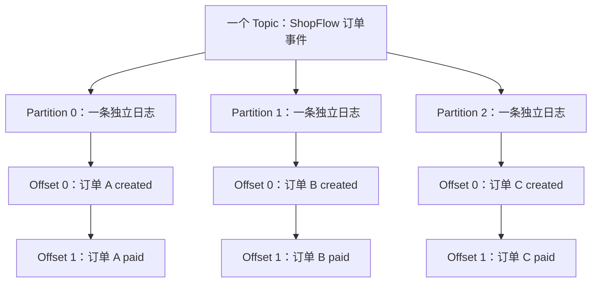
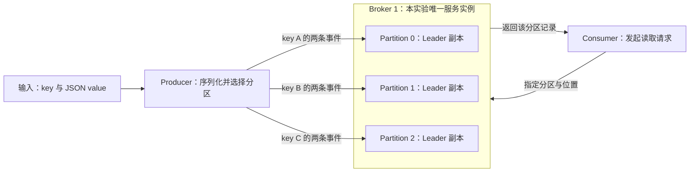

# 第 3 章：Topic、Partition 与 Offset——把订单放进正确的日志

> 贯穿案例：ShopFlow 订单系统。上一章认清了 Kafka 实例、控制角色与磁盘；这一章回答：订单究竟存在哪里，位置怎么找，为什么要拆分？

## 【积木 3-1】导读：先画层级，再谈并行

在[第 1 章](01-why-kafka.md)的答疑中，我们说过：Topic 包含 Partition，Broker 保存分区副本。现在别急着背下一批参数，请先用这句话解释“一个 Broker、一个 Topic、三个 Partition”。如果脑中出现三台机器，或三份完整订单副本，说明还需要把概念拆开。

本章学习目标：

1. 画清 Topic、Partition、Broker 与副本的关系，解释分片为何能提供并行能力。
2. 用 `(topic, partition, offset)` 定位记录，区分日志位置、订单 ID 和消费进度。
3. 解释 Producer 如何利用 key 选择分区，以及顺序保证的条件与边界。
4. 在三分区单节点实验中核对六条订单事件，准确说明证据能证明什么。

沿用[第 2 章](02-kraft-environment.md)的[单节点 Compose](../infra/single-node/compose.yaml)，镜像为 `apache/kafka:4.3.1`。今天不增加 Broker，不开展高可用或多机器吞吐测试；消费组分配与提交机制分别留到第 5、6 章。

## 【积木 3-2】Topic 是逻辑集合，Partition 是里面的独立日志

ShopFlow 的订单事件放进一个 Topic。Topic 是逻辑分类，不是一条必然连续的全局队列。它有三个 Partition 时，就是把记录收纳进三条独立日志；每条日志在末尾追加记录，拥有自己的位置序列。

本章选择三个订单，每个订单先创建、后支付。为便于看图，称它们为订单 A、B、C；实验会生成真实的 key 与订单字段，而不是依赖下面的代号。



注意看：三条日志都可以出现 Offset `0`，它们不是同一条记录。六条事件合起来仍属于一个 Topic；一次成功发布的记录选择其中一个分区，不是因为 Topic 有三个分区就存三遍。重试造成重复是另一类问题。

你可以把 Topic 想成“订单档案类别”，Partition 想成该类别的几本记录册。但记录册的编号不是服务器编号：Partition `1` 不意味着必须放在 Broker `1`，也不意味着只有这台 Broker 能保存它的副本。

## 【积木 3-3】Broker 承载分区副本：分片与复制是两根旋钮

Broker 是运行 Kafka 的服务进程或实例，机器提供它使用的 CPU、内存、网络与磁盘。一个 Broker 可以承载多个 Topic 的多个分区副本；一个 Topic 的分区副本也可以分散在多个 Broker 上。三者不是一一对应关系。

把两个建主题参数并排看：

| 参数 | 回答的问题 | 本实验 |
| --- | --- | --- |
| `--partitions` | 这个 Topic 拆成几条日志？ | `3` |
| `--replication-factor` | 每条分区日志有几个副本？ | `1` |

**Partition 是分片，不是 copy；replication factor 是同一分片的副本数量。**二者在概念上正交：三个分区、一个副本，表示三条不同日志各保存一份；三个分区、三个副本，则是三条日志各有三份副本，不是九个独立分区。副本放置还受到 Broker 数量等实际条件限制，不能在一个 Broker 上假装实现三 Broker 的副本容错。

副本中的 Leader 处理该分区的常规读写，其他副本的复制细节留到第 8 章。本环境只有 Broker `1`，因此三个分区唯一的副本全部位于它上面，`Leader`、`Replicas`、`Isr` 都应对应 `1`。三个 Leader 是三个分区的领导副本，恰好由同一个 Broker 承载，不是三台机器，也不是三个 Controller。

因此，分区数变成三，不会让这台电脑凭空多出磁盘、网卡或节点故障容错能力。

## 【积木 3-4】为什么拆分：让不同工作并行，而不是越多越快

只有一个分区时，该 Topic 的常规写入集中到一个分区 Leader。多个分区让 Leader 可以分布到不同 Broker，使数据和读写负载有机会利用更多资源。这是“可以分散”，不是“创建分区就自动获得性能”。今天全部 Leader 在一个 Broker 上，仍共享本机资源。

另一类并行发生在消费者一侧。**在本课程讨论的普通 Consumer Group 订阅模式下，同一分区同一时刻分配给组内一个 Consumer。**一个 Consumer 可以负责多个分区；三个分区、四个同组消费者时，针对这一个 Topic，最多三个消费者获得分区，剩下的不能靠多启动一个实例来分走半条日志。不同消费组则可以各自读取同一批分区。

这里的上限限定的是普通组订阅的分区分配，不是应用工作线程的绝对上限，也不推广到其他消费模型。业务程序仍可在内部并行处理，但若同一订单的处理完成顺序被打散，需要应用自己解决。

分区也有成本：更多日志文件、索引、元数据、连接与调度管理工作；组内重分配和恢复需要考虑更多分片。并且跨分区没有 Kafka 规定的统一读取总序。若瓶颈是同一个热点订单、下游数据库，或单机磁盘已饱和，继续加分区不一定更快。

我们要问的不是“能不能设成一千”，而是“哪些工作能够独立并行，现有资源承受得住多少分片”。

## 【积木 3-5】Offset 是分区自己的日志位置，不是业务流水号

每个分区维护自己的 Offset，它是 `int64` 日志位置，新分区的记录位置从 `0` 开始。因此，本实验三条分区日志各有两条记录时，位置分别都是 `0`、`1`，不是整个 Topic 连续编号 `0` 到 `5`。

定位记录需要完整坐标：

```text
(topic, partition, offset)
(shopflow.orders.ch03.<runid>, 1, 1)
```

第二行表示本次主题中分区 `1` 的位置 `1`，不表示“订单 1”或“Topic 的第二条消息”。`order_id` 是业务订单标识，`event_id` 是事件标识，Offset 是存储位置；同一订单的创建和支付事件会占用不同位置。

也不要拿 Offset 计算永久业务总量。保留策略可能清理旧日志段，日志压缩可能移除某些旧记录，仍保留的记录位置可以出现空洞；**Kafka 不会为了填洞把后面的 Offset 重新编号**。一条记录曾经位于 `100`，不会因前面记录被清理而变成 `0`。

同名 Topic 删除重建还会进入新的生命周期，位置可能重新从零开始。所以主题名称相同、分区与 Offset 相同，也不能把新旧 Topic 的记录混作同一条。长期保存定位信息时，应同时考虑主题身份或生命周期；本实验使用唯一主题名隔离每次运行，不删除旧主题来制造“干净结果”。

## 【积木 3-6】三个“位置”与日志末尾，别被名字绕进去

常见的 log-end-offset 表示**下一条追加记录的位置**，不是最后一条现有记录的位置。这里说的是本章查询的默认日志末尾语义，不把所有隔离级别下的可见边界都等同于它。

本实验每个分区只有 Offset `0`、`1` 两条记录，所以下一个追加位置是 `2`。运行 `kafka-get-offsets.sh --time -1`，预期每个分区返回末尾 `2`。它不是说“存在 Offset 2 的第三条事件”，也不能把三个 `2` 当成某一分区有六条。

消费者相关的位置再拆三件事：

- **已读位置**：客户端读到哪里，下一次准备从哪里取记录。
- **业务处理进度**：应用真正完成了哪些订单动作。
- **已提交位置**：保存下来、供后续恢复参考的消费进度，通常表达下一条要处理的位置。

例如客户端取回位置 `0`、`1`，并不意味着两笔业务动作已经完成，更不意味着位置已可靠提交。打印到终端也只是读取展示，不是支付入库。第 6 章会仔细讲这三者与失败恢复，本章不修改消费组提交位置。

还有名称陷阱：`kafka-get-offsets.sh` 是查询主题分区位置的工具；`__consumer_offsets` 是保存消费组等内部信息的 Topic。工具名字里的 offsets，不等于“读取这个内部主题便得到订单 Offset”，更不能把订单日志末尾当成消费组已提交进度。

## 【积木 3-7】谁选择分区？先看消息 key，不要只看 JSON

订单 A 的两条事件需要进入同一条日志。常见做法是把订单标识用作 Kafka record 的 key；但 **JSON 中有 `order_id` 字段，不代表发送工具已经设置 Kafka key**。Value 是事件正文，key 是记录的独立部分，必须由生产者明确提供。

本实验输入每行的结构是 `key|JSON`。Console Producer 用 `parse.key=true` 和 `key.separator=|` 拆出两部分；生产者序列化 key、完成分区选择，再向对应分区 Leader 发送。不是 Broker 看懂订单 JSON 后随机安排，也不会按业务规则自动搬动已经写下的事件。



准确的路由规则必须限定客户端与配置。**本实验 Java CLI 默认处理非 null key 时**，以序列化字节计算 stable Murmur2，再取正值对分区数取模。不是所有语言的所有客户端都天然采用同一算法，也不是随手调用语言自带的 `hash(key)` 就能复现。

未显式指定分区、未忽略 key，且分区策略、分区数与 key 序列化保持稳定一致时，同一 key 才能稳定落到同一分区。不同 key 可能碰到同一分区，也不保证业务负载均匀。本实验的辅助程序特意挑选三个 UTF-8 ASCII key，使其按这个默认规则分别落到 `0`、`1`、`2`；这是构造可验收样本，不是声称任意三个订单都自动均分。

无 key 时也不能笼统说“Broker 随机分配”或“默认每条轮询”。Producer 的无 key 路由与批处理留到下一章。

## 【积木 3-8】顺序的边界：同一日志，不等于全局业务时间线

Kafka 的顺序基础是分区内追加顺序。对于本实验同一订单，单个 Producer 依次提交 created、paid，在分区数、序列化与策略固定的条件下，两条事件进入同一分区；发送配置与应用处理也要避免破坏所需顺序。

这不等于 Kafka 替业务保证因果关系。如果两个 Producer 分别发布同一订单的支付与创建，谁先到达并追加，并不会由事件名称自动纠正。即便日志中先创建、后支付，Consumer 将它们交给不同工作线程，支付处理也可能先完成。我们需要明确的是“哪一层的顺序”，不能只说“用了 key 就绝对有序”。

再看两种遍历：

```text
遍历一：P0 created、paid → P1 created、paid → P2 created、paid
遍历二：P2 created、paid → P1 created、paid → P0 created、paid
```

两者都保留每个分区内部的顺序，却给出了不同跨分区展示次序。Kafka 没有规定这三个分区必须拼成哪一条总时间线；这**不代表它随机打乱已存记录，也不证明所有多分区消费必然出现乱序**。应用当然可以自己归并，但若要得到可靠的全局业务顺序，还需要序列号、等待规则等额外协议，不能仅按到达时间猜测。

最后，增加分区不会自动搬迁旧记录。使用“哈希取模分区数”的路由时，分区数从 `3` 增到 `4`，同一 key 的新事件可能改去另一分区，旧事件仍留在原处。不能一边扩分区，一边假定同一订单从此始终共处一条日志。Kafka 也不能像调小线程池那样随意减少 Topic 分区；相关变更必须先评估数据路由与迁移方案。

## 【积木 3-9】实战：六条事件、三条日志、一个精确坐标

完整步骤、实际生成文件与故障排查见[第 3 章实验手册](../labs/ch03-topic-partition-offset/README.md)。在仓库根目录运行：

```bash
bash labs/ch03-topic-partition-offset/verify.sh
```

**目的**：自动启动已有环境并验证分区、key 和 Offset 的关系。**预期**：创建唯一主题 `shopflow.orders.ch03.<runid>`，三个分区、一个副本；生成并发送六条事件，验收成功。本脚本不 force-recreate，不删除 Topic 或卷，也不停止共享环境。

脚本需要 Python `3.9+`，可通过 `PYTHON_BIN` 指定解释器。`lab.py` 只使用标准库生成输入、解析输出与验收，**不是 Python Kafka 客户端**；真正生产和读取使用容器中的 Kafka CLI。

输入顺序是三个订单的 created，再是三个订单的 paid，故不同订单相互穿插。脚本使用一个 Producer 串行输入，解析 key 的参数是：

```text
--reader-property parse.key=true
--reader-property 'key.separator=|'
--command-property acks=all
--command-property enable.idempotence=true
```

前两项配置输入解析，后两项配置生产者；不要混用。单副本下 `acks=all` 不会凭空增加副本或高可用。本章用它们约束实验写入，不展开全部发送可靠性机制。

按手册从脚本输出取得本次主题名，赋给变量 `TOPIC`，再复查元数据：

```bash
docker compose -f infra/single-node/compose.yaml exec -T kafka \
  /opt/kafka/bin/kafka-topics.sh \
  --bootstrap-server kafka:9092 --describe --topic "$TOPIC"

docker compose -f infra/single-node/compose.yaml exec -T kafka \
  /opt/kafka/bin/kafka-get-offsets.sh \
  --bootstrap-server kafka:9092 --topic "$TOPIC" --time -1
```

**目的**：把“几个分区、放在哪里、日志末尾多少”与实际输出对应。**预期**：分区 `0/1/2` 的 Leader、副本、ISR 均对应节点 `1`；末尾输出为本次主题三个分区各 `2`。脚本也保存这两类查询结果，具体目录以运行输出为准。

脚本逐个分区读取，下面演示分区 `1`；换成 `0`、`2` 可分别复核：

```bash
docker compose -f infra/single-node/compose.yaml exec -T kafka \
  /opt/kafka/bin/kafka-console-consumer.sh \
  --bootstrap-server kafka:9092 --topic "$TOPIC" \
  --partition 1 --offset 0 --max-messages 2 --timeout-ms 30000 \
  --formatter-property print.partition=true \
  --formatter-property print.offset=true \
  --formatter-property print.key=true
```

**目的**：直接看记录的分区、Offset 与 key，不依赖消费组分配。**预期**：同一 key 的 created、paid 分别位于 `0`、`1`。`--max-messages 2` 限制展示数量，`--timeout-ms` 避免无记录时一直等待；超时不是“已经找到两条”的证明，要核对输出数量和错误。

最后从完整坐标精确读取第二个事件：

```bash
docker compose -f infra/single-node/compose.yaml exec -T kafka \
  /opt/kafka/bin/kafka-console-consumer.sh \
  --bootstrap-server kafka:9092 --topic "$TOPIC" \
  --partition 1 --offset 1 --max-messages 1 --timeout-ms 30000 \
  --formatter-property print.partition=false \
  --formatter-property print.offset=false \
  --formatter-property print.key=false \
  --formatter-property print.value=true
```

**目的**：只展示该位置的 JSON value。**预期**：唯一事件类型是 `order.paid`，订单标识与分区 `1` 前一条 created 一致。这是直接定位，不是把某个消费组提交位置重置成 `1`。

验收时请逐项确认：三分区结构正确；每分区位置为 `0/1`；同 key 同分区且 created 在 paid 前；六条记录及其完整坐标无重复、无遗漏；末尾均为 `2`。`two-traversals.json` 由已核对记录生成，分别按 `P0→P1→P2` 与 `P2→P1→P0` 展示，保持分区内顺序。它是两个合法跨分区遍历的教学展示，**不是某次 Consumer 随机输出的实测结果**。

本实验能验证路由、分区内日志与精确定位；不能验证多机器吞吐、高可用或真实多 Consumer 的组内分配。不要把“全部通过”扩写成这些未测试的结论。

## 【积木 3-10】自测与下一章

先独立回答，再展开答案：

1. 一个 Topic 三个分区、一个 Broker，是否意味着三台机器或每条事件三份副本？
2. 三个分区、四个同组 Consumer，普通订阅下针对此 Topic 最多几人获得分区？
3. 分区 `0`、`1` 都有 Offset `1`，它们是同一条事件吗？完整坐标是什么？
4. 每分区两条记录，末尾为什么是 `2`？历史清理后能否用 Offset 直接统计订单数？
5. JSON 有 `order_id`，是否自动设置 Kafka key？默认有 key 路由由谁计算？
6. 同 key 一定同分区、绝对有业务顺序吗？增加分区后旧记录和新记录会怎样？
7. 两个保持分区内顺序的遍历次序不同，是否证明 Kafka 随机重排或多分区必然乱序？
8. CLI 打印到 paid，是否证明支付处理和提交完成？本实验是否验证了组分配与高可用？

<details>
<summary>展开参考答案</summary>

1. 都不是。三个分区是三条独立日志；副本数为一，三个 Leader 副本都在 Broker `1`。
2. 最多三个，且取决于订阅和分配结果；一个 Consumer 也可负责多个分区。此结论限定普通组订阅，不限制全部应用线程。
3. 不是。需要 `(topic, partition, offset)`，还要避免跨 Topic 生命周期混淆。
4. 末尾是下一追加位置，已有位置为 `0/1`。保留和压缩不会重编号，可能出现空洞，Offset 不是业务计数。
5. 不自动设置。Producer 序列化 key、选择分区再发送；本实验 Java CLI 默认对非 null key 使用 Murmur2 正值取模，不推广到所有客户端。
6. 需要策略、序列化、分区数等稳定，并满足发布和处理顺序条件；跨 Producer 业务因果不自动保证。增加分区不搬旧记录，新事件可能换分区。
7. 不证明。它只展示没有规定跨分区总序，应用可归并，但可靠业务总序需要额外协议。
8. 都不证明。读取、业务处理、提交是三件事；实验直接指定分区，只有一个 Broker，没有测试组内分配、多机吞吐或高可用。

</details>

官方参考：[Kafka 基础介绍](https://kafka.apache.org/43/getting-started/introduction/)与[Producer 配置](https://kafka.apache.org/43/configuration/producer-configs/)。阅读其他语言或版本的客户端说明时，重点核对分区策略与 key 序列化，不要只记一个哈希公式。

**下一章：第 4 章 Producer、Key 与批处理。**我们会沿着“应用提交记录→分区选择→批次→发送确认”继续拆解，理解 key 与批处理怎样影响路由、吞吐和顺序，而不是停留在 Console Producer 的参数表。

*完成实验和自测后，回到对话说“继续”，我们再进入第 4 章。*
