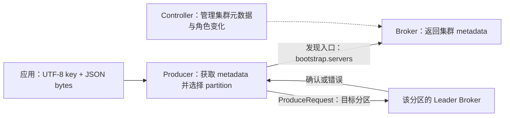
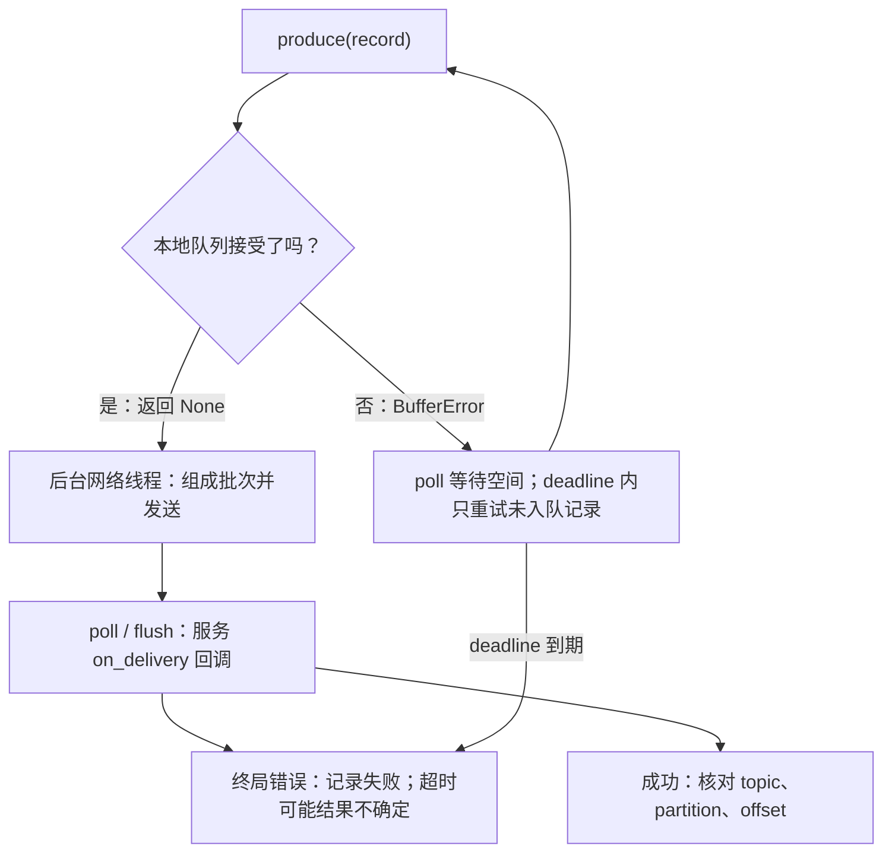

# 第 4 章：Producer、Key 与批处理——从应用提交到真正写入

> 贯穿案例：ShopFlow 订单系统。上一章用 CLI 验证了三条分区日志；今天换成真正的 Python 客户端，把“调用发送函数”与“确认送达”分开，再观察逐条等待与批量提交的差别。

## 【积木 4-1】导读：今天要看懂一条记录的发送旅程

本章学习目标：

1. 区分 record 的 key 与 value，解释序列化、元数据和分区 Leader 如何参与发送。
2. 用明确的客户端分区策略延续上一章的路由结果，指出顺序保证的边界。
3. 分清入队、后台发送、交付回调和退出等待，正确处理队列满与失败。
4. 用真实批次与请求统计比较两种发送方式，不把单机教学结果冒充生产压测。

沿用[单节点 Compose](../infra/single-node/compose.yaml)，不增加 Broker。本章锁定 `confluent-kafka==2.13.2`，是为了复现实验，**不是宣称它永远是最新版**。它基于 `librdkafka`，不是 Python 标准库。前三章的 `lab.py` 只是标准库辅助程序，真正发送使用 Kafka CLI；今天的 `app.py` 才会通过 Python Kafka 客户端联网。

先记住问题：“我调用了 `produce()`，订单事件就一定在 Kafka 里了吗？”答案是否定的。接下来每块积木都在为这个答案补上证据。

## 【积木 4-2】Record 是封装，不是一个自动被理解的字典

ShopFlow 的业务事件可以写成：

```python
{"order_id": "order-3008", "event_type": "order.created"}
```

但 Kafka record 不只是这段正文。`topic` 指定目标主题，`key` 是独立的键，`value` 是正文；还可以提供 `partition`、`headers` 和 `timestamp`。分区与 Offset 则会在成功交付后告诉我们实际日志坐标。Kafka 不负责理解“创建订单”这几个字。

**把 `order_id` 放进 value，不会自动设置 key。**应用必须明确传入 key，并把数据变成客户端能发送的字节。本章将 key 编码为 UTF-8，将 JSON 文本编码为 UTF-8 bytes；不是直接把 Python `dict` 交给这里使用的 `Producer.produce()`。JSON 序列化与 key 序列化是两件事，改变 key 字节会影响哈希路由。

连接也不是“只要找到任意节点，就让它替我转发所有订单”。`bootstrap.servers` 是发现入口。Producer 获取集群 metadata，知道主题有几个分区、各分区 Leader 在哪里，再向相应 Broker 发出常规写入请求。Leader 变化时，客户端需要更新元数据与重试。



图中的 Controller 不是订单消息的转发站。今天 Broker 与 Controller 角色恰好在同一进程里，也不能因此把两种职责混成一件事。宿主机 Python 使用 `127.0.0.1:19092`；容器内 CLI 使用 `kafka:9092`，不要交换两个网络视角。

## 【积木 4-3】Key 稳定路由，要先让两种客户端说同一种语言

上一章限定了 Java CLI 的非 null key 默认 Murmur2 路由。不能把这个默认值直接推广给 Python：本章客户端默认的 `partitioner=consistent_random` 对非空、非 null key 使用 CRC32，空 key 和 null key 则走该策略的随机规则，与 Java CLI 可能选出不同分区。

因此实验显式配置 `partitioner=murmur2_random`。在三个分区、未指定 partition、UTF-8 key 字节相同的条件下，非 null key 与上一章 Java 路由一致：

| Key | 分区 | 发送的事件 |
| --- | --- | --- |
| `order-3008` | `0` | created、paid |
| `order-3001` | `1` | created、paid |
| `order-3000` | `2` | created、paid |

三个 key 是挑选的教学样本，不是“任意三个订单必定均分”。不同 key 可能碰撞到同一分区；同一个热点订单的大量事件仍集中到一条日志，加其他分区不会替这个 key 自动分担。

还要区分 `key=None` 与 `key=b""`：前者没有 key，后者是长度为零但非 null 的 key。在本章 `murmur2_random` 策略下，空字节 key 仍参与哈希，不能当成无 key。无 key 的路由由客户端策略决定，可能结合随机或粘性行为；**不是 Broker 随机安排，也不保证每条轮询**，其他客户端和配置可以不同。

如果显式提供 `partition=1`，就可以覆盖默认的按 key 选择；“同 key 同分区”不能无视这样的调用。扩分区也可能改变哈希取模结果，新事件换分区，旧记录不会自动搬迁。

同一分区保证日志追加顺序，不修复业务因果。两个 Producer 分别先发 paid、后发 created，Kafka 不会因为 key 相同而把已追加记录调换。单 Producer 的发布顺序、协议重试配置及消费端处理方式，都要配合业务所需的顺序。

## 【积木 4-4】Produce 返回只是入队，交付回调才报告结果

Python 客户端的 `produce()` 是异步接口。成功调用返回 `None`，表示记录被本地客户端接受入队，不是 Broker 已确认，也不是“没有返回值所以发送失败”。后台网络线程负责连接、打包和传输；不要画成“每调用一次 poll 才发一次网络包”。

`poll()` 主要服务交付、统计等回调。`on_delivery(err, msg)` 报告 Broker 确认后的成功，或重试耗尽、超时等终局错误。成功时可读取 `msg.topic()`、`msg.partition()`、`msg.offset()`，把实际坐标与业务 key 对照。

下面是**接口示意，不是独立可运行的完整程序**；完整配置、背压、截止时间与退出处理以实验 `app.py` 为准：

```python
import json
from confluent_kafka import Producer

errors, delivered = [], []

def on_delivery(err, msg):
    if err is not None:
        errors.append(str(err))
    else:
        delivered.append((msg.topic(), msg.partition(), msg.offset()))

producer = Producer(config)  # 完整配置见 app.py
key = "order-3008".encode("utf-8")
value = json.dumps(event, ensure_ascii=False).encode("utf-8")
producer.produce(topic, key=key, value=value, on_delivery=on_delivery)
producer.poll(0)
remaining = producer.flush(10)
if remaining != 0 or errors or len(delivered) != 1:
    raise RuntimeError("记录未得到完整成功确认")
```

`poll(0)` 是非阻塞服务回调，不是“保证这一条已经发出”，也不是“保证与下一条组成批次”。交付回调只说明生产者侧的交付结果；消费者是否读取、数据库是否更新，仍是另外两件事。

## 【积木 4-5】队列满、超时、退出：失败不能被一句 flush 掩盖

异步意味着应用可以比网络更快。队列容量不足时，`produce()` 可能抛 `BufferError`，这一条尚未成功入队。正确做法是 `poll()` 服务回调、给队列腾出机会，在明确 deadline 内重试**那条未入队记录**。超过截止时间应失败退出，而不是无限循环或把整个订单流程盲目重发。

相反，已经入队的记录会由客户端按协议重试。应用看到交付超时后再发一次，需要认真考虑重复：**超时结果可能不确定，不等于 Broker 必定没有那条记录**。不能靠“出错了就重新下单”修复所有发送异常。



`flush(timeout)` 服务回调并等待待处理记录，返回**仍未完成的数量**。必须设有限超时并检查返回值。返回 `0` 只代表没有未完成记录，失败记录也可能已经通过回调终结；还应检查错误集合、成功回调数量与预期数量，不能把零当成业务成功。

完整程序在正常路径检查有界 `flush()` 的未完成数量、交付错误和回调数；异常路径再做有限时长的尽力排空，仍传播原错误，不会把失败变成退出码 `0`。有界等待尽力回收结果，不会把前面失败洗成成功。进程崩溃或机器断电时，尚在内存队列的记录可能丢失，`finally` 也不保证执行；订单数据库与消息发布怎样衔接，留到第 11 章 Outbox。

实验启用 `acks=all` 和幂等生产。单 Broker、单副本下，前者不提供多节点容错。幂等机制主要防止生产者协议重试产生重复，不会替应用多次 `produce()` 同一业务事件去重，也不等于外部数据库端到端 exactly-once。副本、可靠性与事务将在第 8、10、11 章继续拆。

## 【积木 4-6】批次按分区积累，请求可以装下多个批次

现在再问：为了保险，每发送一条就 `flush()`，为什么可能慢？因为应用等待这一条结束后才提交下一条，同一分区很难攒起多条尚待发送的记录。

Producer 按分区积累 record batch。一批中的记录属于同一分区；但发往同一个 Broker 的一个 `ProduceRequest` 可以包含多个分区的批次。因此不要把“一批”等同于“一次请求”。统计请求少了和平均批次变大，是相关但不同的证据。

批处理没有把一百个订单合成一条业务事件。记录的 key、value 与日志位置仍独立存在，消费者仍逐 record 获得它们。优化的是传输与存储组织，不是改写业务事件边界。

`linger.ms` 给积累批次一个等待机会，不是端到端交付 deadline，也不表示每条必须等满这个时间；批次先达到容量等条件时可以更早发送。负载、网络、背压和调度又可能让整体交付更久，不能把 `200` 毫秒解释成 SLA。

`batch.size` 是单批容量上限，不是“至少积累这么多字节才允许发”，也不是严格的所有记录大小上限；一条较大的记录不会因为超出普通批次目标就被自动拆成几条。`librdkafka` 还通过 `batch.num.messages` 限制批次记录数，低负载时小批次同样可以发送。

`compression.type=gzip` 对批次压缩，可能减少网络和存储字节，代价是压缩、解压的 CPU。它不是保证总会更快的按钮；重复 padding 很易压缩，也不代表真实订单正文有同样比例。

## 【积木 4-7】参数先认单位和层级，再谈调优

两种对比模式保持下面参数相同，仅改变应用提交与等待方式：

| 本章 librdkafka 参数 | 教学值 | 控制什么 |
| --- | --- | --- |
| `bootstrap.servers` | `127.0.0.1:19092` | 宿主机发现入口 |
| `partitioner` | `murmur2_random` | 非 null key 与 Java 路由对齐 |
| `linger.ms` | `200` | 批次积累的等待机会 |
| `batch.size` | `65536` | 单批字节容量目标上限 |
| `batch.num.messages` | `1000` | 单批记录数上限 |
| `compression.type` | `gzip` | 批次压缩算法 |
| `queue.buffering.max.messages` | `10000` | 总队列记录容量限制 |
| `message.timeout.ms` | `15000` | 客户端消息交付超时 |
| `acks` | `all` | 写入确认要求 |
| `enable.idempotence` | `true` | 启用生产者幂等协议 |
| `max.in.flight.requests.per.connection` | `5` | 单连接在途请求上限 |
| `statistics.interval.ms` | `100` | 统计回调窗口间隔 |

这些是教学值，不是生产最佳配置。`queue.buffering.max.messages` 与 `queue.buffering.max.kbytes` 约束客户端总队列；`batch.size` 约束某个分区的批次，二者不是同一层容量。队列容纳更多不等于 Broker 吞吐更高，还可能占更多内存、延长等待。

参数名也有客户端边界。别把 Java 的 `buffer.memory`、`delivery.timeout.ms` 原样粘进本章 Python 配置；本章用的是 `librdkafka` 名称，交付超时设置为 `message.timeout.ms`。相似功能不代表所有细节相同。

允许五个在途请求，不等于必然破坏顺序；本章幂等配置约束协议行为，也不必为了顺序把所有请求绝对串行化。反过来，这个数字也修复不了两个应用实例错误的业务发布顺序。

## 【积木 4-8】实战入口：隔离依赖，先验六条带 key 的记录

完整操作和排障见[第 4 章实验手册](../labs/ch04-producer-key-batching/README.md)。在仓库根目录运行：

```bash
python3 -m venv .venv
.venv/bin/python -m pip install -r labs/ch04-producer-key-batching/requirements.txt
PYTHON_BIN="$PWD/.venv/bin/python" bash labs/ch04-producer-key-batching/verify.sh
```

**目的**：用 Python `3.9+` 虚拟环境隔离依赖，再选择已安装依赖的解释器运行实验。已有合适环境可直接通过 `PYTHON_BIN` 指定，不必重复创建。脚本不会自动安装依赖或修改全局 Python 配置，兼容 Compose 的两种入口，复用前章 Broker。

每次创建三个独立主题：`shopflow.orders.ch04.<runid>.keys`、`.serial`、`.burst`，都为三个分区、一个副本。完整名称以输出为准；不要删除旧主题来复用 Offset 零点。

keys 试验使用上表三个订单，每个各有 created、paid，共六条。客户端读取 metadata 核对三分区与单副本；交付回调核对实际坐标，再从三个分区起点直接回读，验证 key、正文、数量与 Offset，检查每个订单的创建先于支付。

这里 Consumer 使用 `assign()` 直接指定分区，`enable.auto.commit=false`，没有通过 `subscribe()` 做消费组分配实验。它只是核验生产结果，不代表业务处理已完成，更不是消费组提交进度的演示。第 5 章会专门拆解这个区别。

本章 `app.py` 还有假 Producer 的 self-test，覆盖队列满重试、flush 剩余非零和错误报告等分支。它验证程序处理逻辑，**不是实际断网或 Broker 故障注入实验**；正常联网回读则提供真实交付证据，两类测试不能相互冒充。

## 【积木 4-9】两种发送方式：看真实统计，不预先填漂亮数字

serial 与 burst 各发送同样的 `120` 条事件，序号 `0..119`，每条带 `512` 字节 padding。两个模式各用单个 Producer、同一业务 key，在自己的三分区主题中通过 key 自动路由到一个分区，不显式设置 partition；其他配置保持一致。

- **serial**：提交一条，立即有界 `flush()`，确认后再提交下一条。
- **burst**：循环 `produce()`、`poll(0)`，最后统一有界 `flush()`；队列满仍按截止时间处理。

逐条 flush 会减少攒批机会，通常牺牲吞吐；某些业务确实需要串行等待前一个动作确认，不能为了性能擅自去掉业务约束。Producer `flush()` 也不是 Consumer 的 `commit()`：一个等待发送结果，一个保存消费进度。

验收先看正确性：每个模式都有 `120` 次成功交付，回读 `120` 条记录，key、序号与 Offset 完整，无重复无遗漏，序号按该分区日志保持 `0..119`。再看 `stats_cb` 收集的真实客户端统计：

| 指标 | 该怎样读 |
| --- | --- |
| `batchcnt` 的 `avg` / `max` | 相应统计窗口中批次记录数的平均值 / 最大值 |
| `batchcnt` 的 `cnt` | 批次统计样本数，不是业务消息总量 |
| `brokers.*.req.Produce` | 各 Broker 的累计 Produce 请求计数 |

统计回调需要 `poll()` 或 `flush()` 服务；程序在发送后还做有界采样等待，以免没拿到包含本次发送的窗口就结束。没有统计不是“每批一条”，统计不满足条件也不能偷偷改成通过。累计请求指标与窗口批次统计应分别汇总，不能把窗口平均值简单相加。

批处理验收要求 burst 的实际 `batchcnt.max > 1`，且 Produce 请求少于 serial。你应从本次输出记录实测数字，不照抄一组固定预期。本程序的发送计时不包含元数据准备、回读和末尾采样等待，但仍受单机资源、网络就绪、逐条等待与实际发送调度影响；不能用一次耗时声称生产峰值吞吐，也不能宣布 `linger.ms=200` 最优。这个受控小实验只回答：“在这批相同记录和条件下，应用提交方式是否改变了批次与请求？”

## 【积木 4-10】自测与下一章

先独立回答，再展开答案：

1. value 中有 `order_id`，是否自动有 Kafka key？能直接发送 Python 字典吗？
2. Producer 向 Controller 转发订单吗？bootstrap 地址是否就是所有分区的发送终点？
3. 为什么本章显式设置 `murmur2_random`？`None` 与空字节 key 有何区别？
4. `produce()` 返回 `None`、调用 `poll(0)`，是否证明已写入？队列满重试哪条？
5. `flush()` 返回零为何还要检查回调？交付超时是否证明 Broker 没有记录？
6. 一批就是一次 Produce 请求吗？`linger.ms` 是否必须等满，`batch.size` 是否是最小批量？
7. 开幂等、`acks=all`，是否得到业务去重和单节点高可用？同 key 能否纠正跨 Producer 因果？
8. 为什么既回读又看统计？逐条 flush 与 Consumer commit 是一回事吗？

<details>
<summary>展开参考答案</summary>

1. 不自动设置，key 是独立字段。本章分别发送 UTF-8 key 和 JSON bytes，不把字典直接交给该接口。
2. 不转发。Producer 获取 metadata，定位分区 Leader 后向相应 Broker 写入；bootstrap 是发现入口。
3. 本客户端默认非空、非 null key 用 CRC32，与上一章 Java Murmur2 可能不一致，默认策略对空/null key 另有规则。显式对齐后，非 null 的相同字节在相同分区数下路由一致；空字节是非 null key，`None` 才是无 key，无 key 不保证轮询。
4. 都不证明。返回只说明入队，poll 服务回调；BufferError 后在 deadline 内重试未入队那条，不盲目重发已入队业务事件。
5. 零表示无待完成记录，还需核对错误和成功数量。超时可能结果不确定，不能据此断言 Broker 无记录。
6. 不是，一个请求可装同 Broker 多分区批次。linger 是等待机会，可提前发送；batch.size 是容量上限，不是最低门槛。
7. 都没有。幂等主要处理协议重试重复，单副本 all 不变成高可用；跨 Producer 业务因果仍需应用协议。
8. 回读验证记录正确完整，统计验证批次与请求变化。flush 等生产交付，commit 存消费进度，职责不同。

</details>

官方参考：[Confluent Python 客户端说明](https://docs.confluent.io/kafka-clients/python/current/overview.html)、[librdkafka 2.13.2 配置](https://github.com/confluentinc/librdkafka/blob/v2.13.2/CONFIGURATION.md)。前者是滚动文档，阅读时仍以实验锁定依赖及对应配置为准，尤其别混淆 Java 与 librdkafka 参数。

**下一章：第 5 章 Consumer Group——同一批订单，谁负责哪条分区？**我们会从今天的直接指定分区转向订阅，观察同组分工、不同组独立读取与成员变化，不把“多启动一个程序”简单理解成“每人都能分一半”。

*完成实验和自测后，回到对话说“继续”，我们再进入第 5 章。*
