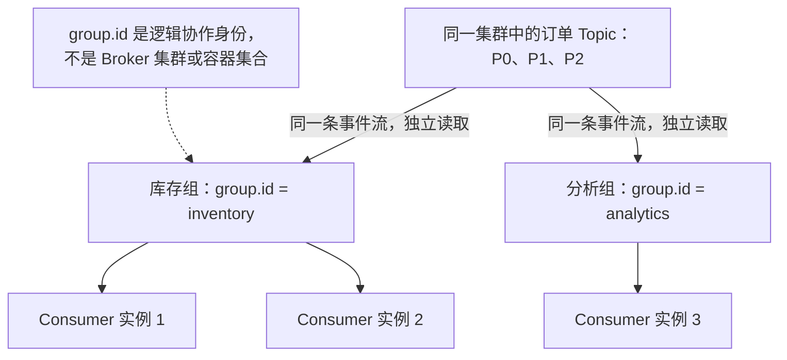
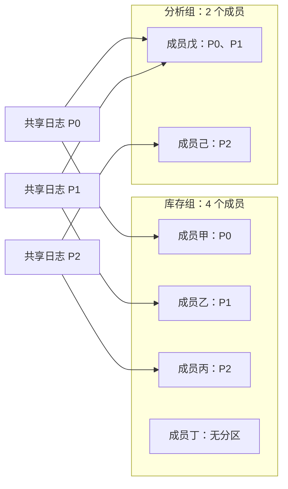

# 第 5 章：Consumer Group——同一批订单，谁负责哪条分区？

> 贯穿案例：ShopFlow 订单系统。上一章确认了 Producer 真正写入的记录，并用 `assign()` 回读。本章改用 `subscribe()`：库存服务需要共同处理订单，分析服务也需要完整事件流，它们应怎样组织消费者？

## 【积木 5-1】导读：先问分工，再问进度

本章学习目标：

1. 分清 Broker 集群、消费组和消费者实例，不按容器或机器数量猜分组。
2. 解释同组分区分工、不同组独立读取，以及消费者数量的并行上限。
3. 认识 Coordinator、组协议与订阅回调，不把消费组画成消息随机派发器。
4. 用真实 Python 客户端证明：生产一次的十二条事件，可以由两个业务组各自完整读取。

我们复用[单节点 Compose](../infra/single-node/compose.yaml)，使用 Python `3.9+` 和锁定的 `confluent-kafka==2.13.2`。本章研究**普通 Consumer Group 的稳定分配阶段**，不演示停成员后的故障恢复，也不推广到 Share Group。第 6 章讲 Offset 提交，第 7 章再实际观察 Rebalance。

先记住一句话：**同组分工，不同组独立；分工单位是分区，不是一条条业务消息。**

## 【积木 5-2】Group 是协作身份，不是一组机器

消费组由消费者配置的 `group.id` 标识。在同一 Kafka 集群中，使用同一个 `group.id` 的普通组成员协作分配订阅分区；相同字符串连接另一个独立集群，不会跨集群组成一组。

一个 member 是一个 Consumer 实例，不是一个 Broker，也不天然等于一个进程。一个进程可以创建多个 Consumer，多个进程、多个容器或多台机器也可以加入同组。部署位置决定运行资源，`group.id` 决定协作身份，别把二者绑死。

可以把库存组理解为一支共同完成同一份工作清单的队伍，分析组则是另一支需要完整清单的队伍。不过这个比喻不能延伸成“前台每来一单就抽签选人”：Kafka 日志先确定分区，队伍内部再按分区分工。业务目的相同也不会自动入组，程序必须配置相同的组身份。

本实验为了容易观察，采用“一个 worker 进程，一个 Consumer 实例”。`inventory-1` 等名称放在 `client.id` 中，便于辨识日志和请求；它不是消费组身份，也不能用它替代 `group.id`。不要把这项教学选择当成 Kafka 的部署限制。



箭头表示读取关系，不表示 Broker 为每个组复制一套订单数据。组各自读取同一份分区日志，消费不会删除记录；历史能否回读，还取决于日志保留情况。

### 一个高频误解：同组消费者的并集，就是整个 Topic 吗？

这个理解抓住了核心，但先把“一个消费者”和“一组消费者”分开：**一个 Consumer 是一个客户端实例，Consumer Group 是一个或多个 Consumer 组成的协作队伍。**不是一个 Consumer 自己变成了很多人，而是我们启动多个 Consumer，让它们使用同一个 `group.id`，通过订阅参加同一个组的分工。

先不管 Coordinator、协议和参数。只看一个三分区 Topic，以及同组的两个 Consumer。在本章普通组订阅、成员都订阅这个 Topic、分配已经稳定的条件下，一种分配是：

```text
订单 Topic 的全部分区：{P0, P1, P2}

库存组（同一个 group.id）
├── Consumer A 负责：{P0, P1}
└── Consumer B 负责：{P2}

负责范围的并集：{P0, P1} ∪ {P2} = {P0, P1, P2}
负责范围的交集：{P0, P1} ∩ {P2} = 空集
```

所以你可以说：**两个消费者负责的分区合起来，覆盖整个 Topic；同组分工时，它们不是各自读取整个 Topic。**A 从 P0、P1 取记录，B 从 P2 取记录。一个组也可以只有一个消费者，那就由这个消费者负责全部三个分区。

但“并集”要区分两种意思：

| 你在合并什么 | 可以得出什么结论 |
| --- | --- |
| 当前分配给各成员的分区集合 | 在上述稳定订阅条件下，合起来覆盖该 Topic 全部分区 |
| 到目前为止各成员已经读到的消息集合 | 只是这个组已经读取的部分，不一定包含 Topic 所有历史，也不一定已经追上最新消息 |

例如 P0、P1、P2 各有四条消息，共十二条。假设本次从每个分区开头读到末尾，A 会读八条，B 会读四条，合起来十二条；不是 A 十二条加 B 十二条。如果 B 暂时只读了两条，组当前合计才读十条，**虽然分区职责已经覆盖完整，实际读取仍有两条没完成**。有些组还会从已提交位置或最新位置开始，本来就不要求读完全部历史；已被保留策略清理的历史也无法再读。

也不要把“消息集合的交集为空”当成永久保证。稳定分配时的分区职责互不重叠，不代表重新分配、失败重启或未提交进度后，不同时间的成员从未读取同一条记录。恢复与重复问题留到第 6、7 章。

如果另外启动一个 `group.id` 不同的分析组，它会有自己的分工和读取进度。库存组内部合起来读一遍，分析组内部也可以独立合起来读一遍；库存读完不会让分析组没东西读。

现在只记住：**Consumer 是队员，Consumer Group 是队伍，Topic 的 Partition 是分给队员的工作范围。“覆盖所有分区”和“已经读完所有消息”是两件事。**

## 【积木 5-3】三个分区怎样分给四个人？

限定所有成员只订阅本实验的一个三分区 Topic。在普通消费组的稳定分配阶段，同一分区只交给组内一个成员；一个成员可以承担多个分区。因此三分区不能靠四名成员变成四条同时分工的分区日志。

| 分区数 | 同组成员数 | 本实验预期分布 |
| --- | --- | --- |
| 3 | 4 | 三人各拿一个分区，一人无分区 |
| 3 | 2 | 一人拿两个分区，另一人拿一个 |
| 1 | 两个不同组，各一人 | 两组各自那一人都可读取该分区 |

谁拿 P0、谁空闲不应硬编码：成员标识和加入过程可能不同。我们验收分布与覆盖关系，不要求 `inventory-1` 永远拿 P0。空闲成员依然可以是活跃组成员，只是没有分配到分区；这不代表进程故障。



这是可能分配的示意，不是固定姓名的实测结果。不同组对同一分区各有自己的读取者，没有违反“组内互斥”。消费者数与 Broker 数没有一一对应：本章一个 Broker 就能服务这六个 Consumer 实例。

## 【积木 5-4】谁协调组？谁真正取数据？

Group Coordinator 是承担组协调职责的 Broker，负责组状态、成员与协议协调；它不是第 2 章的 KRaft Controller。单节点环境里这些职责可能恰好落在同一进程，概念仍应分开。

本实验显式使用 `group.protocol=classic` 和 `partition.assignment.strategy=range`。在 Classic 协议中，组内选出的 leader member 执行分配策略，Coordinator 协调流程并同步分配结果。不能说“Coordinator 一个人全权决定所有分区”，更不是“用户发一条消息，Broker 随机找一个 worker”。

Kafka 4 的新 consumer group protocol 支持 broker-side assignment，这与上述 Classic 路径有区别。今天锁定协议是为了明确实验前提，不宣称所有版本、所有客户端都默认采用同一协议，也不把普通组的结论套给 Share Group。

拿到分配后，Consumer 通常根据 metadata 向相应分区的 Leader Broker 发 Fetch 请求。Coordinator 不转发所有订单数据；Producer 选择了写入分区，消费组再决定组内谁负责读该分区，这是两层不同的决定。

把这两层接起来：订单 key 的字节与生产者分区策略决定它进入哪条日志；库存组的分配决定哪个成员读取那条日志；分析组又有自己的分配。改变 worker 名称不会把历史订单搬到别的分区，增加分析组也不会改变库存组已有的分区路由。排查“订单去哪了”，应分别看写入坐标、组分配和消费进度，而不是只数启动了几个程序。

## 【积木 5-5】从 assign 到 subscribe：这次真的参加组分配

上一章 `assign()` 手动指定回读分区，没有参与消费组动态分配。本章使用 `subscribe([topic])`，让消费者加入组并接受分区分配。别同时手动指定一套分区，再把读到的结果称作自动组分工。

下面只是**接口示意，不是完整可运行的实验程序**。完整的停止条件、超时、报告与异常处理见实验 `app.py`：

```python
from confluent_kafka import Consumer, KafkaException

consumer = Consumer({
    "bootstrap.servers": "127.0.0.1:19092",
    "group.id": group_id,
    "client.id": worker_name,
    "group.protocol": "classic",
    "partition.assignment.strategy": "range",
    "auto.offset.reset": "earliest",
    "enable.auto.commit": False,
    "enable.auto.offset.store": False,
})

def on_assign(current, partitions):
    print("获得分区", [(p.topic, p.partition) for p in partitions])

def on_revoke(current, partitions):
    print("撤销分区", [(p.topic, p.partition) for p in partitions])

consumer.subscribe([topic], on_assign=on_assign, on_revoke=on_revoke)
try:
    while running:  # 停止信号由完整程序管理
        message = consumer.poll(1.0)
        if message is None:
            continue
        if message.error():
            raise KafkaException(message.error())
        print(message.topic(), message.partition(), message.offset())
finally:
    consumer.close()
```

`poll()` 服务回调并返回记录；没有记录时返回 `None`，不代表订阅失败。这里回调只记录生命周期，分配处理交给客户端默认行为，不在回调中强行 `assign()` 或提交 Offset。该客户端库有后台心跳机制，但这不意味着应用可以永久不 poll；`max.poll.interval.ms` 与处理过慢的问题留到第 7 章。

## 【积木 5-6】读到记录，不等于提交进度，更不等于业务完成

`on_assign` 表示获得分区，`on_revoke` 表示分区被撤销。它们不是“订单处理成功”通知。应用如何停止旧任务、安排新任务、处理数据库副作用，需要另外设计，不能看到回调就宣布可靠性成立。

本实验关闭 `enable.auto.commit` 和 `enable.auto.offset.store`，也不显式 commit。这是刻意把分工与持久化进度拆开，而不是推荐所有生产消费者永久不提交。读到一条订单、内存中推进读取位置、保存已提交 Offset、业务数据库更新，是不同动作。

`auto.offset.reset=earliest` 只在没有有效已提交 Offset 等需要重置位置的情况下作为回退规则，不是每次启动都从头读。新组没有历史提交，在记录仍保留时可以从最早可用位置读取；老组有有效提交，通常按自己的提交位置恢复。

今天不提交，所以同组重启也可能再次读到这些事件。**“稳定分配时组内互斥分区”不等于“生产中每条永远只读一次”。**故障、重新分配、提交时机都可能带来重复；即使记录只读了一次，也不能证明扣库存等外部操作实现 exactly-once。第 6、7 章会用实际过程补上这些边界。

不同组有各自进度。分析组慢了，不会替库存组倒退；库存组提交了，也不会替分析组跳过事件。提交的是组的进度信息，不是另外复制出一份该组专属的订单日志。

**Broker 的日志保留不等待所有组读完。**消息消费、Offset 提交都不删原记录；按时间/容量的旧段清理却可以淘汰尚未被某个慢组读取的历史。组之间进度独立，不代表每组拥有独立的永久数据副本；日志删除后，`earliest` 也只能读取仍保留的部分。完整辨析见[第 1 章“消息读完就删吗”](01-why-kafka.md)，第 9 章再做清理实战。

进度也不是整个 Topic 上的一个总数字。三条分区日志各有位置，分给两名成员后，一个成员轮流拿到两条分区的记录，不会因此产生一条统一的全局顺序。观察到某次 paid 比另一个订单的 created 先打印，只能说明应用此次获取和输出的先后；不能从跨分区的混合日志推导所有订单的全局因果顺序。

## 【积木 5-7】实战入口：十二条生产，两套完整读取

完整操作见[第 5 章实验手册](../labs/ch05-consumer-groups/README.md)。在仓库根目录执行：

```bash
python3 -m venv .venv
.venv/bin/python -m pip install -r labs/ch05-consumer-groups/requirements.txt
PYTHON_BIN="$PWD/.venv/bin/python" bash labs/ch05-consumer-groups/verify.sh
```

已有第 4 章虚拟环境可直接复用，不必重建。安装只发生在你明确执行的第二条命令中，脚本不修改全局 Python 配置。

每次创建独立 Topic `shopflow.orders.ch05.<runid>`，三个分区、一个副本；库存组为 `shopflow.ch05.<runid>.inventory`，四个 worker；分析组为 `shopflow.ch05.<runid>.analytics`，两个 worker。完整标识以本次结果为准，不删除旧 Topic 或旧组来重置现场。

单 Producer 延续 `murmur2_random`，每个 key 发送四条事件，`sequence=0..3` 对应 created、paid、packed、shipped：

| Key | 分区 | 本次独立日志中的 Offset |
| --- | --- | --- |
| `order-3008` | 0 | 0、1、2、3 |
| `order-3001` | 1 | 0、1、2、3 |
| `order-3000` | 2 | 0、1、2、3 |

总共生产十二条，必须得到十二次成功交付回调。两组各读十二条，合计二十四次读取，**不是生产了二十四条，也不是每个 Consumer 都读十二条**。

## 【积木 5-8】先证明分配稳定，再发送与验收

编排程序先启动六个 worker，用 AdminClient `describe_consumer_groups` 检查组达到稳定状态且成员齐全。每组成员分区集合必须不重叠，并集必须等于 P0、P1、P2；连续两次稳定快照还要与 worker 的 `assignment()` 一致，再让 Producer 发送。

这样避免把“组还在加入，记录已经发完”当成稳定分工证据。读取完成的 worker 继续 poll 并保持存活，直到两个组都读全十二条；否则先退出者会触发新分配，污染今天要观察的阶段。

不要只截一行“成功读取十二条”就通过验收。四名成员加起来读十二条，仍可能是某条重复、另一条缺失；只有数量与事件身份、分区坐标一起核对，才能排除这种抵消。空闲成员的零记录报告也要保存，它与成员列表共同证明“已加入但无分区”，比只保留三个忙碌成员的输出更完整。

验收至少交叉检查四类证据：

- **成员证据**：Admin 成员结构、分配快照，以及成员仍存活时的 CLI 输出。
- **读取证据**：每个 worker 记录 topic、partition、offset、key、正文和分配回调日志。
- **组内完整性**：每组十二个业务事件 ID 和十二个日志坐标各出现一次，无遗漏；实际读取者与稳定分区 owner 一致。
- **分区内顺序**：每条分区按 Offset `0..3` 读取，对应事件序号 `0..3`；不比较不同分区的全局先后。

库存组应为三名活跃读取者各四条、一名无分区成员零条；分析组应为八条和四条。具体 worker 名称由本次分配决定。跨组坐标相同是预期独立读取，不应把它误判为组内重复。

静态 self-test 检查覆盖、重叠、空闲、重复与遗漏等判定逻辑，不是真实 Broker 故障测试。联网实验对稳定等待和读取设置六十秒截止时间，失败退出并保留现场，不删除 Topic、组或卷，也不强制重建容器。结束后通过 stopfile 停止信号让 worker 正常 `close()`；退出引起的变化不作为本章故障恢复结论。

## 【积木 5-9】读懂现场，再决定是否增加消费者

脚本会在成员存活期间保存发送前后的 `--members --verbose` 和 `--state` 证据。人工查看时，从结果中的 `run.env` 取本次真实组 ID；不要把示例 `<runid>` 原样发给 Kafka。将所选组 ID 放入 shell 变量 `GROUP_ID` 后运行：

```bash
docker compose -f infra/single-node/compose.yaml exec -T kafka \
  /opt/kafka/bin/kafka-consumer-groups.sh --bootstrap-server kafka:9092 \
  --describe --group "$GROUP_ID" --members --verbose

docker compose -f infra/single-node/compose.yaml exec -T kafka \
  /opt/kafka/bin/kafka-consumer-groups.sh --bootstrap-server kafka:9092 \
  --describe --group "$GROUP_ID" --state
```

库存和分析两个组分别查看。容器内使用 `kafka:9092`，不是宿主机 Python 的 `127.0.0.1:19092`。如果默认实验已经结束，成员可能为零或组显示 Empty，这是正常退出，不是此前没有入组；此时应读保存的存活阶段证据。没有提交 Offset 时，进度字段可能为 `-`，不能把它写成“Lag 已经为零”。

真实 ShopFlow 中，库存和分析若误用同一 `group.id`，就会分食事件，而不是各自得到完整流；某些库存事件可能只被分析实例读到。不同业务需要独立完整流，就用不同消费组。

增加消费者应结合分区数、业务吞吐和资源。热点分区不会因旁边多了空闲成员就被自动拆成两半。也别为“每颗 CPU 都忙起来”盲目扩分区：第 3、4 章已经说明，扩分区可能改变 key 路由，同一订单新旧事件的顺序边界也随之变复杂。

例如两名库存成员中，一人承担两个分区且业务处理成为瓶颈，增加到三名可能分摊分区负载；继续增到四名，就多出一个无分区成员。若瓶颈其实在共享数据库、下游接口或某一个热点订单，增加成员未必有帮助。本章十二条事件刻意均匀分布，只验证分工机制，不提供生产容量建议，也不能据此宣称四人一定比两人快。

## 【积木 5-10】自测与下一章

先回答下面九题，再展开答案：

1. 同一进程里的两个 Consumer 必然同组吗？不同机器上的实例能否同组？
2. `client.id` 相同就同组吗？同一 `group.id` 能把两个独立集群合成一组吗？
3. 本章三个分区、四名库存成员各读多少？两名分析成员怎样分？
4. 一个分区能同时由两个不同组读取吗？读取是否删除记录或复制专属日志？
5. Coordinator 是 KRaft Controller 吗？本章 Classic 分配由谁执行，数据从哪里取？
6. `subscribe()` 与 `assign()` 有何区别？回调是否证明业务完成？
7. `earliest` 会让每次启动倒回开头吗？今天重启为什么可能重复？
8. 两组各读十二条是否生产了二十四条？稳定阶段无重复是否证明 exactly-once？
9. A 负责 P0/P1，B 负责 P2，各分区四条消息。A 已读八条，B 已读两条：“负责范围的并集覆盖整个 Topic”和“组已经读完全部消息”，哪句正确？如果组里只有一个 Consumer，它可以负责全部三个分区吗？

<details>
<summary>展开参考答案</summary>

1. 不必然，取决于各自 `group.id` 和所连接的集群；多机实例可以加入同一组。member 是 Consumer 实例，不是进程、容器或 Broker。
2. 都不行。`client.id` 便于辨识客户端；组协作身份是同集群内的 `group.id`，不会跨独立集群自动合并。
3. 库存三人各负责一分区、各读四条，一人空闲零条；分析一人负责两分区读八条，另一人读四条。不硬编码谁拿哪一分区。
4. 可以，互斥边界在组内。消费不删除记录，不为各组复制实体日志，各组进度独立，回读仍受保留限制。
5. 不是。Classic 的 leader member 执行 assignor，Coordinator 协调与同步；Consumer 通常从分区 Leader Broker Fetch。新 consumer 协议的分配路径不同。
6. subscribe 参与组动态分配，assign 手动指定分区不参与该分配。回调只报告生命周期，不证明数据库更新，也不是自动提交进度的证明。
7. 不会，earliest 是没有有效提交时的回退规则。今天关闭自动提交且不显式提交，同组重启可能从最早可用记录重新读；老组有有效提交则按进度恢复。
8. 只生产十二条，共二十四次读取。稳定实验无重复只证明本次验收结果，不覆盖故障、重新分配、提交窗口，更不证明外部业务 exactly-once。
9. 前句正确，后句不正确：分区职责的并集是 P0/P1/P2，但当前只读了十条，尚有两条未读。组可以只有一个 Consumer，在正常稳定订阅该 Topic 的条件下，由它负责全部三个分区。是否读完历史还取决于起始位置、进度和保留范围。

</details>

官方参考：[Kafka 4.3 Consumer 配置](https://kafka.apache.org/43/configuration/consumer-configs/)、[Confluent Python 客户端说明](https://docs.confluent.io/kafka-clients/python/current/overview.html)。配置文档有客户端边界，Python 实验使用 librdkafka 参数；滚动文档也不能替代锁定版本与本章显式协议前提。

**下一章：第 6 章 Offset 提交——读到哪儿、保存到哪儿，重启为什么会重复？**我们会把当前读取位置与已提交进度拆开，观察提交前后重启的差别，再讨论业务处理与提交的先后关系。

*完成实验和自测后，回到对话说“继续”，我们再进入第 6 章。*
