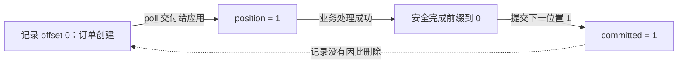
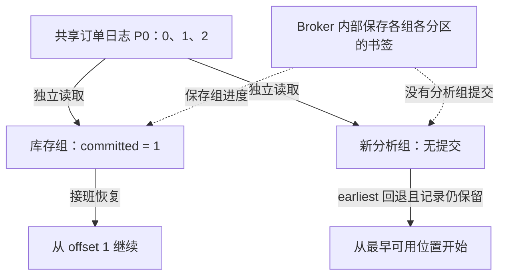

# 第 6 章：Offset 提交——消息还在，重启为什么会重复？

> 贯穿案例：ShopFlow 订单系统。上一章把 Consumer 比作队员、Group 比作队伍，Partition 比作工作范围。这一章只问一件事：队员突然离开，接班的人凭什么知道从哪里继续？

## 【积木 6-1】先不记参数：读书、做题、夹书签

上一章你已经理解：同组队员负责的分区合起来覆盖 Topic，但“领到全部工作范围”不等于“完成全部工作”。现在把一条分区日志想成一本只在后面添页的订单册。

队员读了一页，册子不会少一页；读完后册子也不会销毁。Kafka 消费和提交进度都不删除订单记录。历史最终能保留多久，是另外的保留规则，见[第 1 章](01-why-kafka.md)。保留规则不会等所有队伍读完才清理。

接班问题可以拆成三件事：**眼睛读到哪里、工作做到哪里、书签夹在哪里。**眼睛已经看到后面，不保证前面的库存工作都完成；工作完成了，也不保证书签已经保存。进程突然退出，内存里的阅读位置没了，接班人通常依靠队伍已经保存的书签恢复。

本章目标是辨清这三种进度，用四次不同的退出时机观察遗漏与重复，并写出最容易理解的“处理成功，再提交”循环。先理解现象，再学名字，不需要数据库或分布式系统背景。

阅读时先把“消费成功”拆开问：是程序拿到了消息，还是业务做完了，还是恢复书签保存了？一行“收到订单”的日志只能证明第一件事，不能替后两件事作证。

## 【积木 6-2】四个名字，其实是四个不同的问题

先看一个新建、单分区、连续三条记录的小例子：

```text
分区 P0 的记录：offset 0 → created
               offset 1 → paid
               offset 2 → packed
新组还没有书签：committed = 无提交，不是 0
```

| 名字 | 白话问题 | 例子 |
| --- | --- | --- |
| record offset | 这条记录在这条日志的哪个位置？ | created 的位置是 0 |
| consumer position | 下一次交付给应用的位置在哪里？ | 应用已拿到 0，下一位置为 1 |
| processed 安全进度 | 前面哪些工作已经连续完成？ | 只完成 0，安全下一位置为 1 |
| committed offset | 队伍把恢复书签保存到哪里？ | 提交 1，表示恢复时从 1 继续 |

`processed` 是我们表达业务完成情况的概念，不是 Kafka 自动知道的业务字段。`position` 是客户端下一次交付给应用的位置，**不是后台预取缓冲区最远读到哪里**。客户端可能预先取来更多记录，不能据此宣布应用已经收到或处理它们。

这里最容易错的是加一：**处理 offset 0 成功，应提交 1；连续完成 0..9，应提交 10。**提交的是“下一条从哪里读”，不是“刚才完成哪一条”。这不意味着每个真实日志位置都必有一条应用记录；本实验用新 Topic 的连续位置帮助入门。



新组第一次读到 0 后，完全可能是 `position=1`、`committed=无提交`。读取推进内存位置，不会凭空产生一个持久化书签；别把“无提交”写成“已经提交了 0”。

## 【积木 6-3】书签属于队伍，而且每条分区各有一张

Kafka 按 **`(group.id, topic, partition)`** 保存提交位置，Broker 将这类进度信息保存在内部 Topic `__consumer_offsets` 中。它不是往订单 Topic 又写一条业务消息，更不是删除原订单，也不是确认库存数据库已经更新。

因此库存组在 P0 提交 1，不会替分析组提交 1；同一库存组在 P0 提交 1，也不会替 P1 提交 1。接班的是同组新 Consumer，通过 `subscribe()` 获得分区后，有有效提交通常按那个位置恢复，不要求接班人沿用旧 `client.id`。



`auto.offset.reset=earliest` 是没有有效提交等需要重置时的回退规则，**不是每次启动都倒回开头**。已有有效提交 1，就按 1 恢复；新组无提交且最早记录仍在，本实验从 0 开始。

若选 `latest`，无有效提交时可从当时末端开始，跳过现存但尚未处理的历史。旧提交可能过期，或它指向的记录已因保留策略被清理；遇到这种情况可能按 reset 规则选位置，配置为报错时则失败。`earliest` 也不能找回已经删除的记录。

## 【积木 6-4】“自动”有两层，别把交付当作完成

以下讨论限定本章 `confluent-kafka==2.13.2` 的 Python Consumer，底层使用 librdkafka。两个默认开启的参数不是同一个开关：

| 参数 | 管的事情 | 不知道的事情 |
| --- | --- | --- |
| `enable.auto.offset.store=True` | 消息交付给应用时，把下一位置存到客户端本地 | 业务是否处理成功 |
| `enable.auto.commit=True` | 定期把可提交的本地位置提交给 Broker | 外部数据库事务是否成功 |

“本地储存”像在桌上的便签写位置；“提交”才是把队伍书签交给 Broker 保存。关闭自动提交，不会同时关闭自动储存；两者需要分别配置。

如果应用一次拿到一批记录，或把已交付记录派给后台线程，而业务还没完成，自动储存的位置可能已经在前面。此时定期提交可能越过未完成的工作。问题是**交付与完成脱节**，不是后台预取多少就必然提交多少。

自动提交也不必然错误：简单同步处理、处理足够及时且符合业务容错目标时，可以是合适选择。另一种设计是关闭自动储存，业务成功后调用 `store_offsets(message=msg)`，再让自动提交定期保存这些安全位置。但 `store_offsets()` 本身只更新本地状态，**不是 Broker 已确认提交**，失败时仍有重复窗口。

为把每一步看清，本章同时关闭两个开关，并在处理成功后显式提交。不把这项教学选择当成唯一生产方案。手动提交也不会自动让扣库存与 Kafka 进度变成同一个原子动作。

## 【积木 6-5】先写最简单的顺序循环

下面是最小完整的**阶段示意程序**：命令行传入 Topic 和组 ID，逐条读取、模拟处理、同步提交；完整故障实验在实验目录。示意中的打印不是实际库存事务，也不是持久化业务成功的证明。

```python
import sys
from confluent_kafka import Consumer, KafkaException


def process(msg):
    print("模拟处理成功", msg.offset(), msg.value(), flush=True)


def main():
    topic, group_id = sys.argv[1:]
    consumer = Consumer({
        "bootstrap.servers": "127.0.0.1:19092",
        "group.id": group_id,
        "group.protocol": "classic",
        "auto.offset.reset": "earliest",
        "enable.auto.offset.store": False,
        "enable.auto.commit": False,
    })
    consumer.subscribe([topic])
    try:
        while True:
            msg = consumer.poll(1.0)
            if msg is None:
                continue
            if msg.error():
                raise KafkaException(msg.error())
            process(msg)
            results = consumer.commit(message=msg, asynchronous=False)
            for partition in results:
                if partition.error is not None:
                    raise KafkaException(partition.error)
    except KeyboardInterrupt:
        pass
    finally:
        consumer.close()


if __name__ == "__main__":
    main()
```

`commit(message=msg)` 帮我们提交该消息位置加一，不要提交整批“已经取来但未完成”的记录。同步调用不仅要捕获异常，还要检查返回的 `TopicPartition.error`，不能只看“没有抛异常”。

`asynchronous=False` 等待提交结果；设为 `True` 会立即返回，需要配置 `on_commit`，持续 poll 服务回调，检查失败并设计重试。不要盲目重试旧位置，覆盖更新的提交、导致进度倒退。同步与异步的区别是是否等待确认，**不是是否 exactly-once**。

自动提交关闭时，正常 `close()` 不会替你提交未完成记录；自动提交开启时，关闭可能提交已储存位置，即使应用还没完成相应业务。后台心跳也不能让业务无限处理而不 poll，第 7 章再讨论超时和生命周期。

## 【积木 6-6】实验准备：同一页，在四个时机突然退出

完整步骤见[第 6 章实验手册](../labs/ch06-offset-commits/README.md)，复用[单节点 Compose](../infra/single-node/compose.yaml)。在仓库根目录执行，已有第 4 章虚拟环境可以复用：

```bash
python3 -m venv .venv
.venv/bin/python -m pip install -r labs/ch06-offset-commits/requirements.txt
PYTHON_BIN="$PWD/.venv/bin/python" bash labs/ch06-offset-commits/verify.sh
```

实验使用 Python `3.9+`、锁定客户端 `2.13.2`、单节点 Kafka `4.3.1`；宿主机地址是 `127.0.0.1:19092`。脚本启动共享环境，每次创建独立 Topic `shopflow.orders.ch06.<runid>`，一个分区、一个副本，只生产订单 `order-6001` 的 created、paid、packed 三个独立事件，位置为 0、1、2。

四个组分别是 `shopflow.ch06.<runid>.<scenario>`。不同组互不代替提交，每组第一阶段都先读到 offset 0，随后在指定时机退出，第二阶段启动**不同进程中的同组新 Consumer**，订阅后恢复。

第一阶段用 worker 内部的 `os._exit(42)` 跳过 `finally` 与 `close()`，模拟 Consumer 进程突然死亡；父进程识别这个预期退出码。它不杀 Broker、不模拟主机断电，也不随意终止其他进程。恢复等待协调器发现旧成员离开、完成分配，不用 `seek()`、重置进度或手工 `assign()` 伪造起点。

## 【积木 6-7】四种结果：读了、做了、提交了不能互换

四组都关闭自动储存和自动提交。表中“最终次数”指模拟业务副作用，不是读取次数；第二阶段对每条恢复记录都执行“处理、同步提交”，最终提交到 3。

| 场景 | 第一阶段退出位置 | 退出后的提交 | 第二阶段首条 | 事件 0/1/2 最终处理次数 |
| --- | --- | --- | --- | --- |
| `read_only` | 读到 0，未处理、未提交 | 无提交 | 0 | 1 / 1 / 1 |
| `commit_first` | 读到 0，提交 1，但未处理 | 1 | 1 | 0 / 1 / 1 |
| `process_first` | 处理 0，但尚未提交 | 无提交 | 0 | 2 / 1 / 1 |
| `process_then_commit` | 处理 0，提交 1 获确认 | 1 | 1 | 1 / 1 / 1 |

第一行读到 0 两次，但第一轮没有副作用，所以业务只处理一次。第二行看似恢复顺畅，却在本次正常恢复中漏了业务事件 0（另外做受控重放仍可能补救）：记录还在 Topic，只是这组书签越过它。第三行先做事再保存书签，崩溃后会重新做，证明重复窗口真实存在。

第四行在提交确认后退出，本次各处理一次；它**不证明原子 exactly-once**。若改在处理成功、提交之前退出，就回到第三行。若提交请求的确认结果不明确，也不能凭猜测认定 Broker 没保存或已保存。

模拟副作用是追加本地 JSONL 文件并执行 `fsync`，用于保留进程重启后的证据，不会真实扣库存。它不是外部数据库事务，也不证明主机断电下的端到端持久性。四种情形只研究一条分区，不能从输出顺序推广多分区全局顺序。

## 【积木 6-8】验证证据：Lag 为零，为什么业务还少一条？

请把表当成**预期验收标准**，真实结果以本次运行输出为准，不把静态自测冒充 Broker 实验。脚本分别记录 `before`、`after_cut`、`after_resume` 的提交查询和 CLI 组描述。

进度查询由独立只读 Consumer 调用 `committed()`，不订阅、不加入组，避免查询者影响分配。新组 `before` 是无提交；第一阶段读到 0 时应用下一位置为 1，退出后 Broker 进度却可能仍无提交，也可能是 1，取决于场景。最终四组都应提交 3。

验收要同时看日志坐标、进度和副作用文件：`summary` 应列出每组事件 0、1、2 的处理次数，检查遗漏与重复，而不只是总数。实验还直接回读 offset 0，证明提交之后原记录依然存在。脚本保留 Topic、组与数据卷，不靠删除现场或强制重建得到干净结果；等待设置截止时间，失败保留证据。

从本次结果取真实组 ID 放入 `GROUP_ID`，在仓库根目录查看：

```bash
docker compose -f infra/single-node/compose.yaml exec -T kafka \
  /opt/kafka/bin/kafka-consumer-groups.sh --bootstrap-server kafka:9092 \
  --describe --group "$GROUP_ID"
```

`CURRENT-OFFSET` 看的是**组在该分区的提交位置**，不是每个客户端的内存 position。实验末端为 3，四组提交都为 3，Lag 都为 0，然而 `commit_first` 的业务文件仍缺事件 0。

所以 Lag 大致是日志末端位置减提交位置，不是“没做完的订单数”。没有提交不能按 0 擅算；日志空洞、事务记录、异常的未来提交等也会影响解释。**Lag 为零只能辅助观察消费进度，不能证明业务完整，更不能证明业务恰好执行一次。**

## 【积木 6-9】进阶：提交安全水位，不是最大已完成编号

回到多分区，每个分区各算自己的安全进度。假设 P0 三条任务里，0 完成、1 未完成、2 完成，不能因为“最大完成的是 2”就提交 3：那会在重启时跳过尚未完成的 1。此时只能提交 1，等待中间工作完成后再前进。

这里的“连续完成前缀”指沿日志读取顺序，中间没有尚未完成的应用工作，不要求真实 Kafka 日志每个整数位置都存在应用记录。新 Topic 的 0、1、2 只是便于演示。

同一分区派给多线程时，“谁完成就提交谁的位置”不安全，需要跟踪完成前缀；初学者先逐条顺序处理最容易验证。换到 P1 又有独立水位，不能拿 P0 的完成位置替 P1 提交。分区被撤销后，旧 worker 还在做事或提交，也有所有权与隔离问题，留到第 7 章。

每处理 N 条再提交，可减少提交频率，但会扩大失败后重复处理的窗口，不意味着批量提交一律不可靠。核心仍是提交不能越过未完成工作，重复副作用需要另外解决。

Kafka 书签与外部业务是两个系统：先保存书签可能漏业务，先做业务可能重做。第 10 章讲 Kafka 范围内的事务，第 11 章讲业务幂等、去重与业务更新放进同一数据库事务，以及 Outbox；不把 Kafka 事务误当作任意外部数据库的自动原子提交。

手动重置组进度，本质是移动书签，回放仍保留的历史；它不回滚已产生的副作用。操作前应停止相关组并评估重复处理风险。本章只认识概念，不提供可直接误执行的重置命令。

## 【积木 6-10】自测与下一章

先答八题，再展开答案：

1. 消费或提交以后，原订单消息会被删除吗？
2. 新组读到 offset 0 后，position 是多少？committed 必然是 1 吗？
3. 连续处理完 offset 0..9，应该提交 9 还是 10？书签属于谁？
4. 同组重启配置 earliest，一定从头读吗？新组配置 latest 有什么风险？
5. 自动储存、自动提交有什么不同？只关自动提交够不够解释业务完成？
6. 四场景中，哪个漏处理 0，哪个重复处理 0？正常场景各一次证明 exactly-once 吗？
7. offset 0、2 完成而 1 未完成，可以提交 3 吗？同步提交只需检查异常吗？
8. CLI 显示提交 3、Lag 0，就能证明三个业务事件都完成吗？

<details>
<summary>展开参考答案</summary>

1. 不会。消费和提交不删除原记录；保留策略可以独立清理历史，也不等待所有组完成。
2. 本实验下一交付位置为 1，但仍可能无提交。无提交与提交 0 不是一回事，也不能按预取末端解释 position。
3. 提交 10，表示下一位置。提交按组、Topic、分区保存；其他组和其他分区不会跟着改变。
4. 不一定，有有效提交按提交恢复；earliest 是回退规则。latest 在无有效提交时可跳过现存未处理历史，已删除历史则无法恢复。
5. 自动储存更新本地可提交位置，默认交付时推进；自动提交定期保存到 Broker。两者都不知道业务是否完成，只关一个不会改变另一个。
6. commit_first 漏处理，process_first 重复；read_only 只是首次多读但未做副作用。process_then_commit 本次各一次不消除处理与提交之间的失败窗口。
7. 不可以，安全下一位置只能是 1。同步提交还要检查返回分区的 error；同步和异步只是等待确认方式，不是 exactly-once 等级。
8. 不能。commit_first 就是反例；Lag 观察组位置与日志末端的差距，不核实外部业务副作用。

</details>

官方参考：[Confluent Python API](https://docs.confluent.io/platform/current/clients/confluent-kafka-python/html/index.html)、[librdkafka 2.13.2 配置](https://github.com/confluentinc/librdkafka/blob/v2.13.2/CONFIGURATION.md)、[Kafka 4.3 Consumer 配置](https://kafka.apache.org/43/configuration/consumer-configs/)。Python 参数以客户端及锁定版本为准，不把 Java 配置直接照搬。

回看[第 5 章](05-consumer-groups.md)：分工回答“谁负责”，提交回答“从哪继续”，业务完成还需要自己的证据。

**下一章：第 7 章 Rebalance——队员加入、离开或处理超时，分区怎样交接？**我们将实际观察消费者生命周期、超时与所有权变化，继续补上故障恢复边界。

*完成实验和自测后，回到对话说“继续”，我们再进入第 7 章。*
