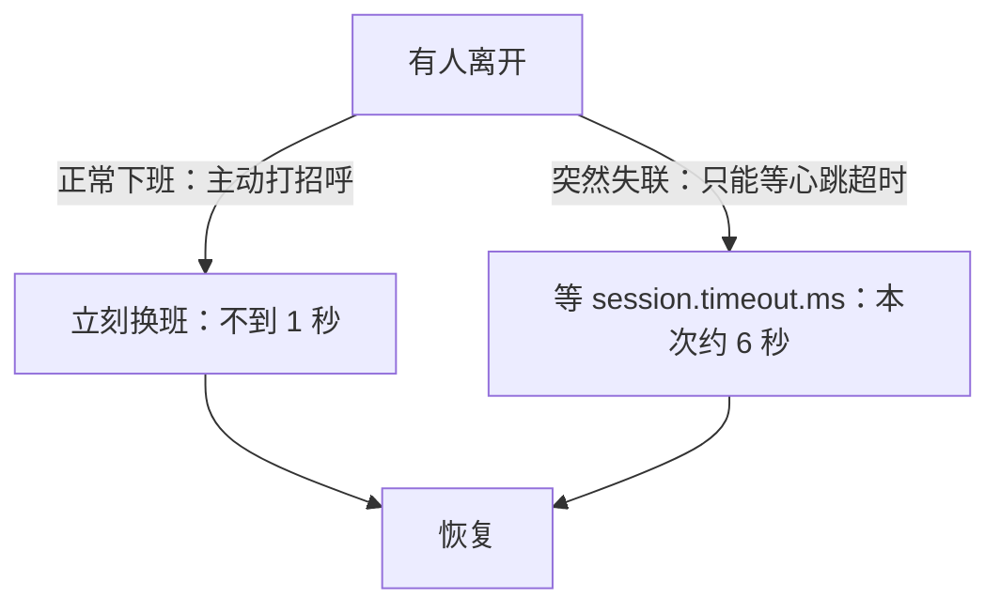

# 第 7 章：Rebalance——队伍换班，分区怎么交接？

> 一句话：只要队伍人数变了，全队就要重新分一次活。这个动作叫 **Rebalance（重平衡）**。
> 本章实验：一个人干 → 加一个人 → 有人猝死 → 有人正常下班，看三次换班分别会发生什么。

## 【积木 7-1】先看一个餐厅场景

餐厅有 3 个包间，原本只有服务员小王，3 间都归他管。

- 来了新服务员小李：经理马上重新分——小王管 2 间，小李管 1 间。
- 小李正常请假、打了招呼：经理立刻知道他走了，重新把 3 间分给小王。
- 小李突然翘班、电话不接：经理要先"等一等"，确认他真的不来了，才能把包间还给别人。

Kafka 消费组就是这个餐厅：

| 餐厅 | Kafka |
| --- | --- |
| 包间 | 分区（Partition） |
| 服务员 | 消费者（Consumer） |
| 重新分活 | Rebalance |

上一章讲"每个人怎么记自己的书签"，这一章讲**换班**。

## 【积木 7-2】什么时候会触发换班？

| 触发原因 | 例子 |
| --- | --- |
| 新成员加入 | 扩容：从 1 个消费者变成 2 个 |
| 成员正常离开 | 程序重启、主动下线、优雅退出 |
| 成员突然失联 | 崩溃、断网，心跳停了 |
| 处理超时被踢 | 一条消息处理太久，太久没回来"打卡" |
| 订阅变化 | 换了订阅的主题、主题增加了分区 |

记住一句话：**只要"队伍名单"变了，全队就要重新分活。**

两个常见误会先澄清：

- **不是"每个人至少管一个分区"**：一个人可以管 0 个、1 个或多个分区。人比分区多时，多出来的人就是闲着（第 5 章见过 4 个人管 3 个分区）。
- **不是只有"有人断开"才换班**：有人**加入**也要换班（1 个人干 3 间 → 来新人后变成 2+1）。断开只是最常见的一种。

## 【积木 7-3】换班怎么换：先全部收回，再重新发

本实验用的经典模式叫"全体重分"（Eager）：


两个关键词，记住就行：

- **revoke**：分区被收回（喇叭喊"先都停一停"）
- **assign**：领到新分区（重新开工）

注意：即使小王手里的分区"看起来没变"，Eager 模式也要先交回、再发下来。所以**换班期间整队会短暂停一下**，不会"边跑边交接"。

还要注意：换班后的分区是队伍**按规矩重新分**的，不是"谁抢到归谁"，也不是"硬塞给别人"。原来的包间可能分给小李；小李接手后，是从书签位置继续读的（上一章的规矩）——所以书签没提交，就可能重读。

## 【积木 7-4】正常下班 vs 突然失联

两种离开方式，换班速度差很多：

| | 怎么离开的 | 经理多久知道 | 本实验实测 |
| --- | --- | --- | --- |
| 正常下班 | 主动打招呼（close） | 立刻 | 约 **0.8 秒**换班完成 |
| 突然失联 | 没打招呼，心跳停了 | 等心跳超时（session.timeout.ms） | 约 **6.1 秒**才换完 |



为什么失联要"等"？因为经理分不清你是真没了还是网络抖了一下。心跳超时（`session.timeout.ms`）就是"失联判定线"：

- 调小：发现快，但网络一抖动就可能**误判**服务还活着的人失联，冤枉。
- 调大：容忍抖动，但真出事时换班更慢。

还有一个容易忽略的超时：`max.poll.interval.ms`。就算网络正常，**一条消息处理太久、太久不回来 poll**，也会被当成"失联"踢出队伍，触发换班。名字先记住，报告里会见到它。

## 【积木 7-5】换班时，没提交的活会重做

回忆上一章：接手的人只看**书签（committed offset）**，不看你干过什么。

- 小王读到 Offset 5、活也干了，但**书签没提交**；
- 换班把分区给了小李；
- 小李看到书签还停在 3 → **从 3 重读、重做**。

所以换班前，把已经干完的活的**书签提交掉**，是减少重复的常规动作。

这次实验我们故意**全程不提交书签**，让换班的"重复效果"直接现形。

## 【积木 7-6】实验：三次换班

在仓库根目录执行（复用之前的虚拟环境）：

```bash
PYTHON_BIN="$PWD/.venv/bin/python" bash labs/ch07-rebalance-lifecycle/verify.sh
```

脚本会依次导演四幕：

| 幕 | 动作 | 预期 |
| --- | --- | --- |
| 1 | 小王（member-a）独自上线 | 3 个分区全归他 |
| 2 | 小李（member-b）加入 | 3 分区分成 2+1 |
| 3 | 小李猝死（不打招呼直接消失） | 等约 6 秒超时，3 间还给小王 |
| 4 | 小李二号（member-b2）上班 → 正常下班 | 秒级换班，3 间还给小王 |

脚本只中断**它自己启动的消费者进程**，不动 Broker、不删数据。

## 【积木 7-7】实测结果：三个数字 + 一个意外

从"触发换班"到"重新稳定"，实测：

| 场景 | 实测耗时 |
| --- | --- |
| 新成员加入（1 人 → 2 人） | 约 **2.0 秒**，分区分成 2 + 1 |
| 突然猝死（2 人 → 1 人） | 约 **6.1 秒**（等会话超时） |
| 正常下班（2 人 → 1 人） | 约 **0.8 秒** |

意外的是读取次数：整个实验只生产了 **6 条消息**，却总共被读取了 **30 次**——平均每条被读了 5 遍。

为什么？因为**全程没有提交书签**：每次换班后，接手的人从各自的最早位置重读。换班本身不制造重复，**"换班 + 没书签"才制造重复**。这正是第 6 章和本章连起来的结论：

> **换班前提交已完成的进度，接手的人才能少走回头路。**

## 【积木 7-8】自测

先回答，再展开答案：

1. 说三个会触发换班的原因。
2. Eager 模式换班时，手里分区没变的人也要交回再领吗？
3. 正常下班和突然失联，哪种换班更快？为什么？
4. `session.timeout.ms` 调小有什么好处和风险？
5. 一条消息处理太久不回来 poll，会怎样？跟哪个参数有关？
6. 换班时没提交书签，接手的人会怎么做？
7. 实验里 6 条消息被读 30 次，是 Kafka 出 bug 了吗？
8. 想减少换班带来的重复，换班前该做什么？

<details>
<summary>展开参考答案</summary>

1. 新成员加入、成员离开（正常或崩溃）、处理超时被踢、订阅或分区数变化——任意三个即可。
2. 要。Eager 模式先全体交回（revoke）、再重新分配（assign），所以换班期间全队短暂暂停。
3. 正常下班更快（本次约 0.8 秒）。因为它主动打招呼，Broker 立刻知道；崩溃只能等心跳超时（本次约 6 秒）才能确认。
4. 好处：发现失联更快、换班更快。风险：网络一抖动就可能误判正常人失联，造成不必要的换班。
5. 会被当成失联踢出队伍、触发换班。相关参数是 max.poll.interval.ms。
6. 只认书签：书签停在哪，就从哪重读——已干但没提交的活会重做。
7. 不是。因为实验全程没提交书签，每次换班后接手的人从最早位置重读，属于预期行为。
8. 换班前把已干完的活的书签提交掉（在 revoke 回调里做是常见做法），让接手的人从正确位置继续。

</details>

官方参考：[Kafka 4.3 Consumer 配置](https://kafka.apache.org/43/configuration/consumer-configs/)、[Confluent Python 客户端](https://docs.confluent.io/platform/current/clients/confluent-kafka-python/html/index.html)。

**下一章：第 8 章 副本与故障——Broker 挂了，消息会丢吗？**我们会第一次搭三节点集群，亲手停掉一个 Broker，看数据还在不在、写入还能不能继续。

*完成实验和自测后，回到对话说"继续"，我们再进入第 8 章。*
