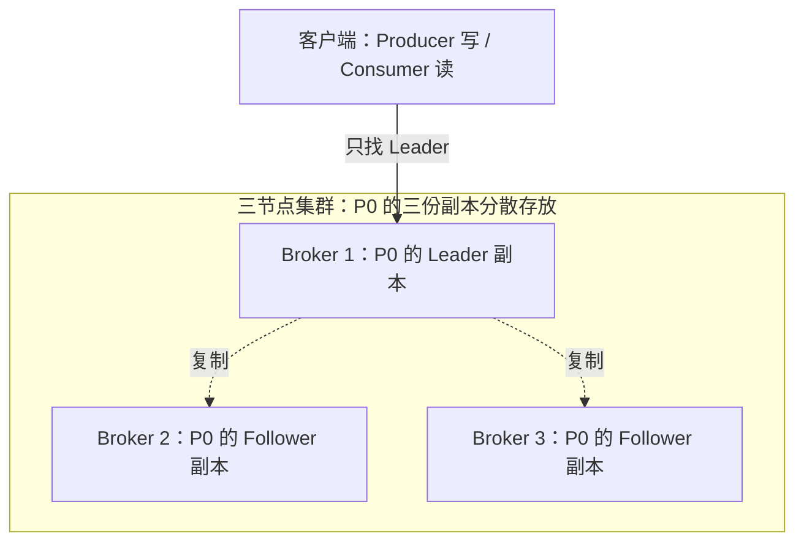
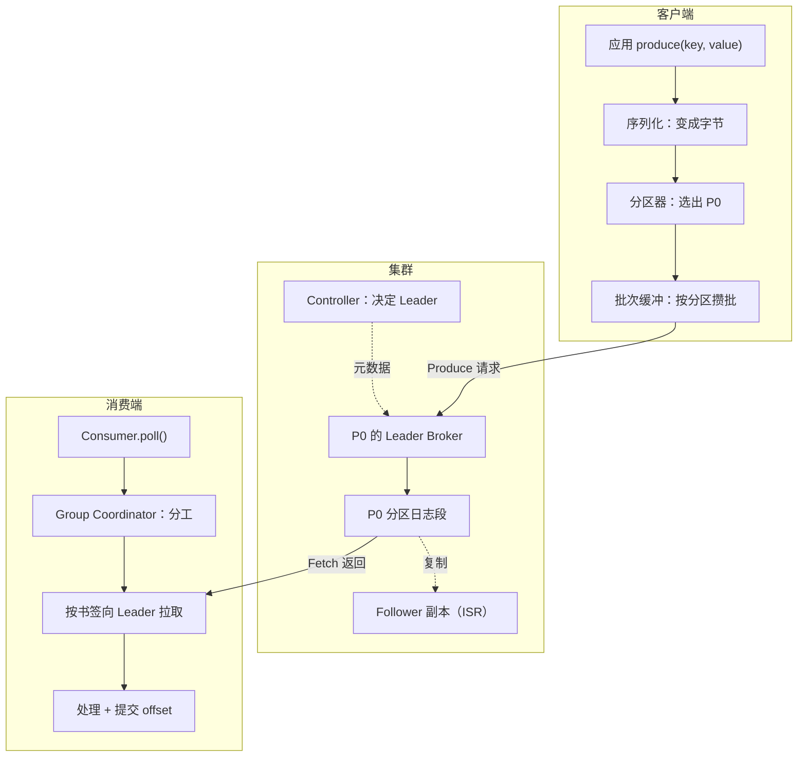

# 第 8 章：副本、Leader、ISR——Broker 挂了，消息会丢吗？

> 前七章都是单副本：数据只有一份，机器一挂就全没了。
> 这一章第一次搭三节点集群，亲手停掉一台 Broker，看数据还在不在。

## 【积木 8-1】先记住三个词

把分区日志想成一份重要文件：

- **副本（Replica）**：同一份文件复印几份，分开放。副本数 = 复制因子（RF）。
- **Leader / Follower**：每个分区有一份"正本"（Leader），读写都找它；其他是"复印件"（Follower），只负责跟着抄。
- **ISR（In-Sync Replicas）**：跟得上进度的副本名单。掉队的不算。

这张图别读反：**不是分区把数据“写给” Broker，而是分区的副本就住在 Broker 的磁盘上。**

- 分区 P0 是数据单位，它不飘在网络里。
- P0 的 Leader 副本在 Broker 1 上，两个 Follower 副本在 2、3 上。
- 客户端说“读 P0”，实际动作是：先查元数据，找到 P0 的 Leader 在哪台 Broker，再去那台机器读。

所以“读分区”和“读 Broker”不是二选一：**读的是分区，落点是存着它 Leader 的那台 Broker**。Broker 负责存放和服务读写，它自己不消费数据。

多 Broker 的作用也不只是高可用：不同分区的 Leader 可以分散到不同机器，分担存储和读写压力；只有再叠加**多副本**，才获得“挂一台还能活”的高可用。3 台 Broker 但 RF=1，挂了照样不可用。

## 【积木 8-2】acks：写到几份才算"成功"？

Producer 发送时可以选：

| acks | 什么时候算成功 | 白话 |
| --- | --- | --- |
| 0 | 发出去就算 | 喊一嗓子，不管有没有人听见 |
| 1 | Leader 收到就算 | 交给正本就行，复印件不管 |
| all | 所有 ISR 都收到才算 | 正本和所有跟得上的复印件都点头 |

本章用 **acks=all**：慢一点，但不会"正本点头了、复印件还没抄，正本一挂就丢"。

## 【积木 8-3】实验设计：两个 Topic 做对照

| Topic | 分区 | 副本数 | min.insync.replicas | 想看什么 |
| --- | --- | --- | --- | --- |
| 主 | 3 | 3 | 2 | 挂一台还能读写 |
| 小 | 1 | 2 | 2 | 少一份就写不进 |

`min.insync.replicas=2` 的意思是：**至少 2 份确认，才准写入。**

## 【积木 8-4】实测：停掉一台 Broker

三台都健康时：主 Topic 每个分区的副本和 ISR 都是 [1,2,3]。

现在停掉 2 号（它正好是 P0 的 Leader）：

- **3.43 秒**后选出新 Leader（P0 换到 3 号）。
- 主 Topic 的 ISR 从 3 变 2（[1,3]）。
- 主 Topic 继续读写：故障前 6 条，故障期间又写 3 条，9 条全部读得到。
- 小 Topic 的写入被明确拒绝：`NOT_ENOUGH_REPLICAS`（凑不够 2 份确认）。但**读取正常**，之前那条还读得到。

一句话：**能扛的继续扛；扛不住的明确拒写，而不是悄悄丢。**

## 【积木 8-5】那 3.4 秒里，内部发生了什么？

停掉的虽然是 P0 的 Leader，但 P0 还有另外两份副本；只要 ISR 里还有跟得上的副本，就能顶上。

反过来想：如果 ISR 里只剩 Leader 自己（其他副本都掉队了），acks=all 就等不到确认，写入会变慢甚至失败——**这是保护，不是故障**。

## 【积木 8-6】把 Broker 修回来

重新启动 2 号：**3.61 秒**后它追上进度，主 Topic 的 ISR 回到 [1,2,3]，小 Topic 也回到 2 份。再写小 Topic，成功。

## 【积木 8-7】结论

| 问题 | 答案 |
| --- | --- |
| 单副本挂了会怎样 | 数据没了。前 7 章的环境没有容灾能力 |
| RF=3 能扛几台 | 1 台。同时挂 2 台，就凑不够 2 份确认 |
| 小 Topic 为什么挂一台就写不进 | 它只有 2 份副本，还要求 2 份确认，少一份就不达标 |
| 拒写是坏事吗 | 不是。宁可写不进，也别"以为写成功了，其实只剩一份" |

生产上的保命组合通常是：**RF=3 + min.insync.replicas=2 + acks=all**。

副本不是越多越好：RF=3 就是 3 份存储、3 份跨机流量；通常 3 份够用，跨机房另算。

边界也要记：这次是**正常停机**，选主很快；断电或崩溃要等心跳超时（第 7 章那套）。ISR 也可能因副本落后而缩小，不是永远三份。更不是"绝对不丢"。

## 附：一条数据从写到读的全程

把前面几章串成一条线：

1. 应用调用 `produce(key, value)`；序列化器把两者变成字节。
2. 分区器按 key 选出 P0（同 key 通常同分区），记录进入按分区组织的批次缓冲。
3. 客户端查元数据，找到 P0 的 **Leader** 在哪台 Broker，发出 Produce 请求。
4. Leader 把记录追加到**日志段**；**Follower** 向 Leader 拉取，跟得上进度的进入 **ISR**。
5. `acks=all` 时，ISR 确认后回调才报成功；`min.insync.replicas` 不够则明确拒写。
6. 消费端 `poll()` 入组；**Group Coordinator** 分配分区，并保存各组的提交位置。
7. Consumer 从**书签**位置向 P0 的 Leader 拉取记录，处理成功后再提交下一位置。
8. 日志删除由**保留策略**按时间/容量执行，与“有没有被消费”无关。

| 组件 | 一句话职责 |
| --- | --- |
| Producer | 组织记录、选分区、发送并处理回调 |
| Serializer / Partitioner | 变成字节；决定去哪个分区 |
| Controller | 管理元数据、决定分区 Leader，不搬消息 |
| Broker（Leader / Follower） | 存日志、接待读写、复制副本 |
| Group Coordinator | 组内分工、保存提交位置 |
| `__consumer_offsets` | 存放各组的书签 |
| 保留策略 | 按时间/容量删除旧日志段 |

## 【积木 8-8】自测

1. 副本和分区是什么关系？RF=3 是三条分区吗？
2. Leader 和 Follower 各干什么？读写找谁？
3. ISR 是什么？为什么它会变小？
4. acks=0 / 1 / all 分别什么时候算成功？
5. 停掉一台 Broker，主 Topic 为什么还能写？选新 Leader 花了多久？
6. 小 Topic 为什么挂一台就写不进？拒写是坏事吗？
7. RF=3 能同时扛两台挂掉吗？
8. 单副本环境（前 7 章）有容灾能力吗？

展开参考答案

1. 一个分区可以有多份副本；RF=3 是同一个分区复制三份，不是三个分区。
2. Leader 负责读写，Follower 跟着复制；客户端读写都找 Leader。
3. ISR 是跟得上 Leader 的副本名单；副本落后、Broker 挂掉都会让它变小。
4. acks=0 发出去就算；acks=1 Leader 落盘就算；acks=all 等所有 ISR 确认才算。
5. 因为还有另外两份副本，ISR 里会选出新 Leader；本次约 3.4 秒。
6. RF=2 且要求 2 份确认，少一份就不达标，所以拒写。这是保护：避免写下后只剩一份。
7. 不能。三份里挂两台只剩一份，低于 min.insync.replicas=2。
8. 没有。单副本时 Broker 一挂，该分区的数据就不可用/可能丢失。

官方参考：[Kafka 4.3 副本与 ISR](https://kafka.apache.org/43/configuration/broker-configs/)、[Topic 配置](https://kafka.apache.org/43/configuration/topic-configs/)。参数含义以锁定版本为准。

**下一章：第 9 章 日志段、保留与压缩——文件层面的"删除"到底怎么发生？**我们会用小的日志段，亲眼看到旧段被删、以及 compact 只留每个 key 的最新值。

*完成实验和自测后，回到对话说"继续"，我们再进入第 9 章。*
