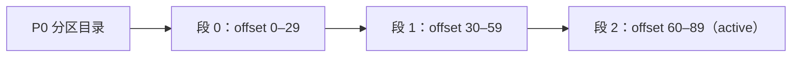
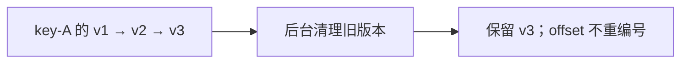

# 第 9 章：日志段、保留与 compact——消息什么时候真的消失？

> 前面反复说过：消费不会删消息，提交 offset 也不会删消息。
> 这一章打开 Broker 的磁盘，看它到底按什么规则删、compact 又和你以为的“压缩”有什么不同。

## 【积木 9-1】日志不是一个文件，而是一摞“分册”

一个分区在磁盘上是一个目录，里面不是一个巨大的日志文件，而是多个**日志段（Log Segment）**：



- 文件名就是这一段的起始 offset，例如 `00000000000000000030.log` 表示从 30 开始。
- 写满 `segment.bytes`，或者到了 `segment.ms`，就滚动出一个新段。
- 只有最新一段（**active**）还在写，旧段封存不动。
- 为什么分段？删除、按 offset 查找、复制和清理，都以“段”为单位更简单。

可以想成一本账本写满一册就换下一册，旧册打包放起来。

## 【积木 9-2】delete：整册淘汰，不是撕掉某一页

最常见的清理策略是 `cleanup.policy=delete`，它看两个限制：

| 限制 | 参数 | 含义 |
| --- | --- | --- |
| 时间 | `retention.ms` | 这一段最多保留多久 |
| 容量 | `retention.bytes` | 每个分区最多保留多少字节 |

**两个都设置时，满足其中一个就可能触发清理**，不是必须同时满足。真正执行的是 Broker 的后台线程，检查间隔由 `log.retention.check.interval.ms` 控制，默认 5 分钟。本章为了观察，把它调成了 2 秒。

关键点：

- 删除单位是**整个封存的段**，不会从段中间抽掉几条。
- **active 段不删**，否则正在写的数据就没了。
- 所以最早可读位置（low watermark）会**跳着上涨**，而不是一条一条右移。
- 被删掉的历史，消费者再从头读就会得到 offset 超出范围；没删的部分仍然能读。

## 【积木 9-3】实测：90 条消息，少了一册

实验创建一个单分区 Topic：`retention.ms=12s`、`segment.ms=1s`，分三批各写 30 条。

| 观察项 | 实测 |
| --- | --- |
| 日志段 | 3 个 → **2 个** |
| 最早可读 offset | 0 → **30** |
| 末尾 offset | 90（不变） |
| 等待时间 | 约 **8.2 秒**（后台检查每 2 秒一次） |

被删掉的是 `00000000000000000000.log` 整个文件；`30` 和 `60` 两个段还在。此时从 offset 0 读会失败，但从 30 开始仍然读得到。

这就是“消费不删、保留才删”的物理证据。

## 【积木 9-4】compact：按 key 留最新，不是 gzip

另一种策略叫 `cleanup.policy=compact`，中文常叫**日志压实**。它和第四章的 gzip 压缩不是一回事：

- gzip 压的是传输/存储的**字节**，解压后内容完全一样。
- compact 清理的是**同一个 key 的旧版本**，只保留最新值。



规则和边界：

- 只处理**封存的段**，active 段不清理。
- 是后台异步过程，不是写入瞬间去重。
- 清理后 offset 仍然保留原来的编号，可能中间有“空洞”，不会重新编号。
- 值设为 `null` 的记录叫**墓碑（tombstone）**，表示删除这个 key，过 `delete.retention.ms` 后才可能真正消失。
- 适合存“最新状态”：配置、地址、库存快照。
- **不适合存完整事件历史**：订单的 created、paid、packed 如果都用同一个 key，compact 会把前两步清掉，只剩最后一步。

## 【积木 9-5】实测：180 条变成 63 条

同一批 180 条记录（3 个 key，每个 key 20 个版本）写进两个 Topic：

| Topic | 策略 | 读到的条数 |
| --- | --- | --- |
| 对照 Topic | delete | **180** |
| compact Topic | compact | **63** |

三个 key 的最新值都正确（seq=19）。为什么不是 3 条？

- 每个封存段里，compact 只保留每个 key 的最新值；
- 最后一个 active 段没有参与清理，仍保留这一段的 20 个版本；
- 所以最终是“每个 key 的老版本被清掉，但活跃段里的历史还在”。

结论：**compact 不是“去重成一条”，而是让每个 key 最终收敛到最新值。**

## 【积木 9-6】磁盘该留多少？

粗略估算：

```text
原始占用 ≈ 每天写入量 × 保留天数 × 副本数
```

例如每天 10 GB、保留 7 天、RF=3：`10 × 7 × 3 = 210 GB`，还没算索引、段文件余量和峰值。

`segment.bytes` 只影响“切成多少个文件”，不改变总数据量。compact 能省多少，取决于同一个 key 重复了多少次。

**保留策略不是备份。** 它只负责淘汰旧数据，不负责恢复误删。

## 【积木 9-7】四个常见误会

1. **“消费完就删了”**：不会。删不删看保留策略。
2. **“提交 offset 会删消息”**：不会。书签只是读取进度。
3. **“compact 就是 gzip”**：不是。compact 按 key 清旧版本，gzip 压字节。
4. **“compact 完只剩一条”**：不一定。active 段还在，且清理是异步的。

## 【积木 9-8】自测

1. 一个分区为什么会有多个 `.log` 文件？
2. 删除日志的单位是单条消息还是整个段？active 段会被删吗？
3. `retention.ms` 和 `retention.bytes` 同时设置时，必须两个都超过才删吗？
4. 为什么删除后最早可读 offset 会从 0 直接跳到 30？
5. compact 和 gzip 的区别是什么？
6. compact 之后 offset 会重新编号吗？
7. 为什么本次 compact 后还有 63 条，而不是 3 条？
8. 订单的 created、paid、packed 事件适合用 compact 吗？

<details>
<summary>参考答案</summary>

1. 日志按段滚动，写满 `segment.bytes` 或到了 `segment.ms` 就生成新段；旧段封存。
2. 整个段；active 段不会被删。
3. 不是，满足时间或容量其中一个就可能触发。
4. 最老的整段被删掉，它的起始 offset 是 30，所以 low watermark 跳到 30。
5. compact 按 key 清理旧版本；gzip 压缩字节，解压后内容不变。
6. 不会，offset 是写入时确定的，compact 只留下空洞，不重编号。
7. 每个封存段保留每个 key 的最新值，但 active 段不清理，仍保留最新一段里的 20 个版本。
8. 不适合。compact 会只留下最后状态，丢掉完整过程；完整事件流应该用 delete 保留窗口。

</details>

下一章讲 **At-most/at-least/exactly-once 与事务**：消息可能重复，业务怎么做到“只生效一次”？说“继续”就开始。
