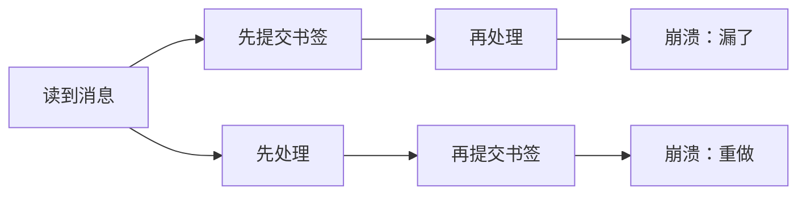
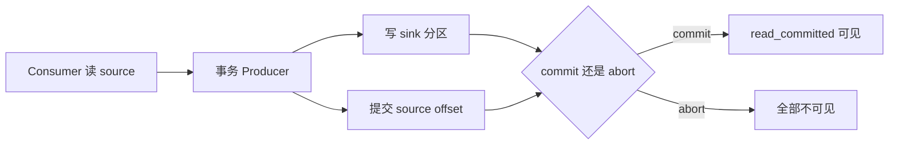

# 第 10 章：At-most / at-least / exactly-once 与事务

> 第 6 章说过：宁可重复，不要漏。
> 这一章回答两个更狠的问题：重复怎么消掉？Kafka 的 exactly-once 到底管到哪一步？

## 【积木 10-1】三种语义，差别只在“什么时候记书签”

还是用读书打比方。书签就是提交的 offset。

| 语义 | 顺序 | 崩溃后果 |
| --- | --- | --- |
| at-most-once | 先记书签，再干活 | 可能**漏**，绝不重复 |
| at-least-once | 先干活，再记书签 | 可能**重复**，绝不漏 |
| exactly-once | 干活和记书签一起生效 | 对结果只生效一次 |

前两种都很好实现。第三种难在：**“处理结果”和“书签”必须同时成功或同时失败。**

## 【积木 10-2】Kafka 的 exactly-once 是一个闭环

Kafka 的事务把三件事绑在一起：

1. 把结果消息写到下游 Topic；
2. 把消费到的位置提交到 `__consumer_offsets`；
3. 要么全部提交（commit），要么全部回滚（abort）。

配套角色：

- **Transaction Coordinator**：Broker 上的事务协调器，记录事务状态。
- **transactional.id**：事务生产者的身份；重启后用同一个 ID 会“ fencing”掉旧的僵尸实例。
- **read_committed**：消费者只读已提交的数据；`read_uncommitted` 会看到回滚的数据。

## 【积木 10-3】实测：提交三条，回滚两条

实验往同一个 Topic 写两组消息：

- 第一组 3 条，`commit`；
- 第二组 2 条，`abort`。

| 读取方式 | 读到条数 | 内容 |
| --- | --- | --- |
| `read_committed` | **3** | 只有第一组 |
| `read_uncommitted` | **5** | 两组都看见 |

回滚的两条实际 offset 是 **4、5**，不是 3、4。为什么？因为 offset 3 被**提交标记（control batch）**占了：它写在日志里，但普通消费者看不到。

所以：**回滚不是“没写过”，而是“写了但对你不可见”。**

## 【积木 10-4】EOS 闭环：读三条、写三条、书签三条

实验再做一次完整的“读 → 处理 → 写”：

- 从 source 读 3 条；
- 在同一个事务里往 sink 写 3 条；
- 用 `send_offsets_to_transaction` 把 source 的 offset=3 一起提交。

结果：

| 观察项 | 结果 |
| --- | --- |
| sink 记录 | 3 条 |
| 已提交 offset | 3 |
| 同组重启后再读 | **0 条** |

这就是 Kafka 内部的 exactly-once：**结果和进度一起提交，重启不重做。**

## 【积木 10-5】幂等生产者 ≠ 业务去重

`enable.idempotence=true` 解决的是：生产者内部重试导致同一条消息写两遍。它给每条消息带 PID + 序列号，Broker 会拒掉重复序号。

但它管不了**应用自己调用两次 produce**。实测：同一个 key、同一个 value 发两次，即使开了幂等，读回来仍是 **2 条**。

事务也管不了业务重复：两次业务请求就是两条不同记录，除非你用唯一键、数据库约束或去重表。

## 【场景】扣库存与发事件，能放进一个事务吗？

库存服务读到 `order.paid`，要扣库存，再发 `inventory.deducted`。

- 先扣库存、再发事件：发事件失败，库存扣了，下游不知道。
- 先发事件、再扣库存：扣库存失败，下游以为已经扣了。

Kafka 事务只能把“发事件 + 提交消费 offset”绑在一起，**扣数据库不在这个事务里**。所以真正落地要么把扣减结果也写成 Kafka 消息，要么用 Outbox / 幂等表（下一章）。

## 【积木 10-6】代价和边界

- 事务有额外开销：协调器交互、控制标记、提交延迟。
- 一个 `transactional.id` 同时只能有一个活跃生产者，旧实例会被 fencing。
- `read_committed` 的消费者会跳过回滚数据，但 offset 仍可能不连续。
- **Kafka 事务只覆盖 Kafka 内部**：写数据库、发短信、调用外部 API 都不在事务里。
- 外部副作用要靠幂等键、去重表或 Outbox（下一章）。
- 不是所有场景都需要事务：日志采集能接受重复时，at-least-once 更简单。

## 【积木 10-7】四个常见误会

1. **“exactly-once 就是消息绝对不重复”**：不是，是重复对结果不生效。
2. **“开了幂等就不会有重复”**：只防生产者重试，不防应用重复发送。
3. **“事务能管数据库”**：不能，Kafka 事务只覆盖 Kafka 读写。
4. **“abort 等于没写”**：写进了日志，只是 `read_committed` 看不见。

## 【积木 10-8】自测

1. at-most-once 和 at-least-once 的关键区别是什么？
2. 为什么 at-least-once 可能重复？
3. Kafka 事务把哪三件事绑在一起？
4. `read_committed` 和 `read_uncommitted` 的区别？
5. 回滚的两条消息为什么从 offset 4 开始？
6. 幂等生产者能防止应用调用两次 produce 吗？
7. Kafka 事务能保证数据库写入也不重复吗？
8. 什么情况下 at-least-once 就够了？

参考答案

1. 先提交还是先处理：先提交可能漏，先处理可能重。
2. 处理成功、提交之前崩溃，重启会从旧书签重读，于是重复处理。
3. 写下游消息、提交消费 offset、以及 commit/abort 的原子可见性。
4. `read_committed` 只返回已提交事务的数据；`read_uncommitted` 连回滚数据也能看到。
5. offset 3 被提交标记占用；回滚消息从 4 开始，标记对普通消费者不可见。
6. 不能。幂等只防生产者内部重试，两次应用调用仍是两条记录。
7. 不能。Kafka 事务不覆盖外部数据库，需要业务幂等或 Outbox。
8. 能接受重复、下游可幂等处理，或重复代价很低的场景，比如日志采集。

下一章讲 **业务幂等、Outbox 与 CDC**：Kafka 事务管不到数据库，那“扣库存 + 发事件”怎么不重复、不丢？说“继续”就开始。
