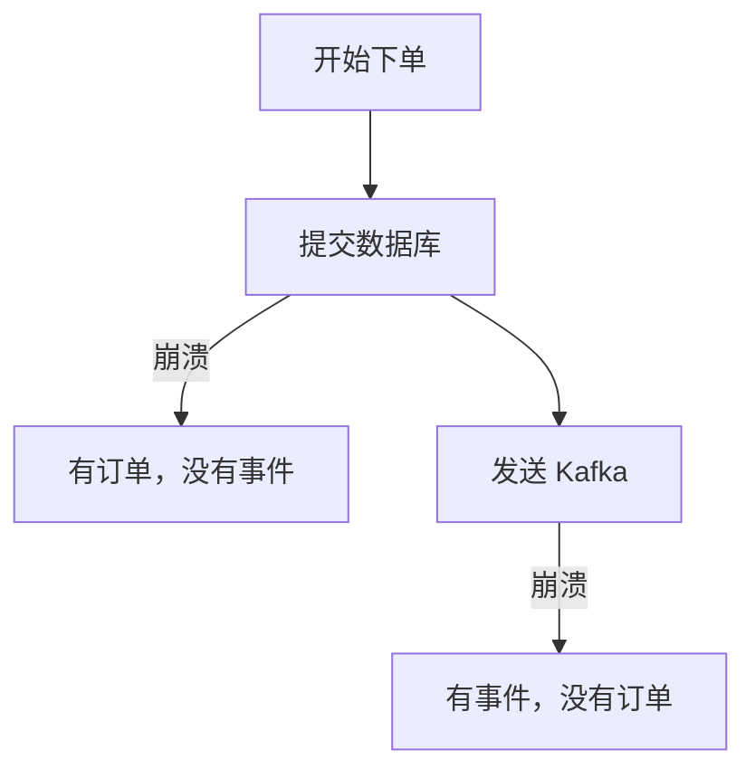
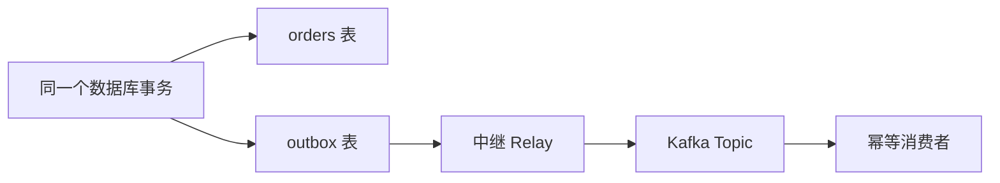

# 第 11 章：业务幂等、Outbox 与 CDC

> 第 10 章说 Kafka 事务只管 Kafka 内部。
> 那“订单落库 + 发订单事件”这种跨数据库和 Kafka 的写入，怎么才能不重、不漏？

## 【积木 11-1】双写为什么一定会出问题

假设下单要做两件事：

1. 往数据库写订单；
2. 往 Kafka 发 `order.created`。

两条路没有共同的事务，中间任何一步崩溃都会不一致：



- 先写库、后发事件：库成功、发事件失败 → 下游永远不知道这笔订单。
- 先发事件、后写库：事件成功、写库失败 → 下游收到“幽灵订单”。

重试也救不了：重发可能重复，不重发可能丢。

## 【积木 11-2】Outbox：把“要发的事件”先写进数据库

解决办法很朴素：**不要直接发 Kafka，先把事件写进数据库的 Outbox 表。**

关键是一个数据库事务同时完成：

```sql
BEGIN;
INSERT INTO orders(...);
INSERT INTO outbox(event_id, payload, published) VALUES (..., 0);
COMMIT;
```

要么订单和事件都成功，要么都失败，不再有中间状态。

然后由一个**中继（Relay）**后台任务：

1. 读 `published=0` 的 Outbox 行；
2. 发送到 Kafka；
3. 成功后把该行标记 `published=1`。



Outbox 表就是“待发件箱”，和业务数据同生共死。

## 【积木 11-3】中继崩溃：重复不可避免

第 3 步有一个无法消除的窗口：

> Kafka 已经收到消息，但 `published=1` 还没来得及写，进程崩了。

重启后中继看到这一行仍是 `published=0`，只能再发一次。

所以 Outbox 提供的是 **at-least-once**，不是“只发一次”。**重复必须由消费端解决。**

## 【积木 11-4】幂等消费：同一事件只生效一次

消费者不能假设消息只来一次。做法是：

1. 每条事件带一个全局唯一的 `event_id`；
2. 消费时，在**同一个数据库事务**里：
   - 往 `processed_events(event_id PRIMARY KEY)` 插一条；
   - 执行业务动作（扣库存、写订单状态）；
3. 插入撞唯一键，说明这条已经处理过，直接跳过。

```sql
BEGIN;
INSERT INTO processed_events(event_id) VALUES ('evt-1');  -- 重复会失败
UPDATE inventory SET deducted = deducted + 1 WHERE order_id = 'order-1';
COMMIT;
```

去重表和业务动作在同一个事务里，才能真正“要么都生效，要么都不生效”。

## 【积木 11-5】实测：双写缺口与 Outbox

实验用 SQLite 模拟业务库，用真实 Kafka 收事件。

| 场景 | 结果 |
| --- | --- |
| 只写库、未发事件 | 订单在，事件 **0** 条 |
| 只发事件、写库回滚 | 事件 **1** 条，订单 **0** 行 |
| Outbox 同事务 | 订单 1 行 + Outbox 1 行 |
| 中继发完崩溃 | 已发 1 条，`published` 仍为 0 |
| 中继重试 | 再发 1 条，Topic 共 **2 条** |
| 朴素消费 | 扣库存 **2 次** |
| 幂等消费 | 生效 **1 次**，跳过 1 次，库存 **1** |

这组数字就是整章的核心：

> **Outbox 保证不丢；重复交给幂等消费；两者合起来才是“效果上只一次”。**

## 【积木 11-6】CDC：不轮询，直接读数据库日志

中继用定时轮询 `outbox` 表，简单但有两个成本：延迟和数据库查询压力。

CDC（Change Data Capture）换一种方式：**读数据库的事务日志**（MySQL binlog、PostgreSQL WAL），把行变更转成事件。

常见组合是 **Outbox + CDC**：

- 业务仍然在同一个事务里写 orders 和 outbox；
- Debezium 之类的工具直接 tail Outbox 表的变化；
- 不需要轮询，顺序也更自然。

也可以直接对业务表做 CDC，但那样数据库表结构就变成了对外契约，改字段容易影响下游；Outbox 多一层，换来更清晰的事件契约。

## 【积木 11-7】边界与常见坑

- Outbox 表会一直增长，要定期归档或删除已发送的行。
- 多实例中继要加锁（如 `FOR UPDATE SKIP LOCKED`）或分区，避免同一行被两个实例同时发。
- 事件顺序：同一订单的事件要保证进入同一分区，否则下游可能先看到“支付”后看到“创建”。
- 幂等键要全局唯一，不能只用自增 ID（不同库会撞）。
- 去重表也会增长，需要保留窗口；窗口外重复仍可能发生。
- “效果上只一次”只覆盖你写了幂等逻辑的副作用，外部短信、邮件也要各自幂等。

## 【积木 11-8】自测

1. 双写的两个失败窗口分别会造成什么？
2. Outbox 表里的 `published` 字段是干什么的？
3. 为什么中继重试会造成重复？
4. 幂等消费的去重表为什么必须和业务动作在同一个事务？
5. `event_id` 应该怎么设计？
6. Outbox 和 CDC 是什么关系？
7. 直接对业务表做 CDC 有什么风险？
8. Outbox + 幂等消费能保证“绝对只发一次”吗？

<details>
<summary>参考答案</summary>

1. 先写库后发事件会“有订单没事件”；先发事件后写库会“有事件没订单”。
2. 标记这一行是否已经成功发送，避免中继重复发送已完成的记录。
3. 消息已发出、标记未写就崩溃，重启后中继仍会读到 `published=0` 的行并再发一次。
4. 否则可能出现“去重记录写了、业务没做”或“业务做了、去重记录没写”的不一致。
5. 全局唯一、稳定、可重放，例如业务单号 + 事件类型 + 版本，或 UUID。
6. Outbox 是待发事件表；CDC 是读取数据库日志的搬运方式，可以 tail Outbox 表，替代轮询。
7. 表结构变成对外契约，字段变更会直接影响下游；也容易把内部数据暴露出去。
8. 不能保证“只发一次”，只能保证“不丢 + 重复不产生额外效果”。

下一章讲 **消息契约、Schema 演进与 Kafka Connect**：事件字段改了，老消费者怎么办？说“继续”就开始。
