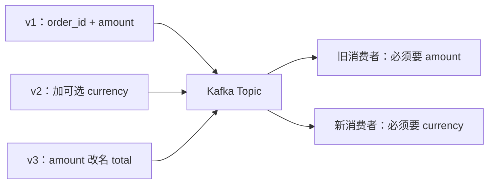
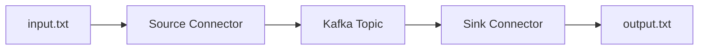

# 第 12 章：消息契约、Schema 演进与 Kafka Connect

> 事件一旦发出去，字段就不只属于你。
> 改一个字段名，可能同时弄坏上游和下游；这一章讲怎么改得不疼，以及外部系统怎么接进来。

## 【积木 12-1】事件就是一份契约

生产者发一个 JSON，消费者按字段名取值——这看起来只是“传数据”，其实是双方签了一份隐式合同：

- 字段叫什么、什么类型；
- 哪些必填、哪些可选；
- 缺字段时用什么默认值；
- 字段的含义（`amount` 是分还是元？）。

一旦生产者独立部署、消费者也在独立升级，**这份合同就不能靠“大家记得”来维护。**

## 【积木 12-2】兼容性有三个方向

| 方向 | 含义 |
| --- | --- |
| 向后兼容（backward） | 新消费者能读旧数据 |
| 向前兼容（forward） | 旧消费者能读新数据 |
| 双向兼容（full） | 两个方向都行 |

这三个方向不是一回事。看实验里的三种事件：

实测结果：

| 事件 | 旧消费者 | 新消费者 |
| --- | --- | --- |
| v1（无 currency） | 正常 | **失败：缺 currency** |
| v2（加可选 currency） | 正常 | 正常 |
| v3（amount 改名 total） | **失败：缺 amount** | 正常 |

所以：**加一个可选字段可以是向后兼容，但旧消费者未必能读新数据；改名则两边都危险。**

## 【积木 12-3】常见改动，哪些会炸

| 改动 | 风险 |
| --- | --- |
| 加可选字段 + 默认值 | 通常安全 |
| 加必填字段、无默认值 | 旧数据读不了 |
| 删除字段 | 依赖它的消费者会炸 |
| 改字段名 | 等价于删旧字段 + 加新字段 |
| 改类型（int → string） | 通常不兼容 |
| 复用旧字段名表达新含义 | 最隐蔽，数据和语义都会错 |

实验里的兼容检查器也给出同样结论：v1→v2 无问题；v2→v3 报“删除了 amount、currency 变必填、新增 total 无默认值”。

## 【积木 12-4】Schema Registry 是干什么的

只靠 JSON 约定，没人强制检查。Schema Registry 是一个独立服务：

- 集中存放每个 Topic 的 Schema 版本；
- 给每个版本分配 ID；
- 按策略检查新版本是否兼容（BACKWARD / FORWARD / FULL / NONE）；
- 消息里只带一个 schema ID，消费者按 ID 取 Schema。

常见格式是 Avro、Protobuf、JSON Schema。注意：

- **Registry 不是 Broker 的一部分**，要单独部署、备份。
- 它管的是“结构”，不管业务语义。
- 兼容性策略要在 CI/发布流程里真正执行，否则只是摆设。

## 【积木 12-5】Kafka Connect：把外部系统接进来

Connect 是 Kafka 自带的集成框架，核心就两类连接器：

- **Source**：从外部系统读数据，写进 Kafka；
- **Sink**：从 Kafka 读数据，写到外部系统。

几个角色：

- **Worker**：运行连接器的进程；有 standalone（单进程）和 distributed（集群）两种。
- **Task**：真正搬运数据的工作单元，一个连接器可以拆多个 Task。
- **Converter**：决定消息怎么序列化（JSON、Avro、String）。
- **Offset**：记录搬运进度；Source 记录读到文件哪一行，Sink 记录消费到哪个 offset。

本章实际启动了一个 `connect-standalone` 容器，用 `FileStreamSource` 把 3 行文本写进 Topic，再用 `FileStreamSink` 写回文件：

| 观察项 | 结果 |
| --- | --- |
| 输入文件 | 3 行 |
| Topic 记录 | 3 条 |
| 输出文件 | 3 行 |
| 启动到完成 | 约 73 秒 |

Connect 负责的是**搬运、进度、失败重试和并行**，不是业务转换的万能工具；复杂清洗还是要写处理程序或 SMT。

## 【积木 12-6】边界与坑

- Connect 的文件连接器适合教学；生产常用 JDBC、S3、Elasticsearch 等连接器。
- Source 的“至少一次”取决于连接器和目标；Sink 也不自动等于 exactly-once。
- Connect 默认可能自动建 Topic；本实验 Broker 关闭了自动创建，所以脚本先建 Topic。
- Converter 和 Schema Registry 是两件事：Converter 管序列化，Registry 管结构版本。
- 改 Schema 前先跑兼容性检查，再发布；不要直接上线试。

## 【积木 12-7】自测

1. 为什么说事件是“契约”，不只是 JSON？
2. 向后兼容和向前兼容分别指什么？
3. 加一个可选字段并给默认值，通常安全吗？
4. 把 `amount` 改名成 `total` 为什么危险？
5. Schema Registry 存在消息里的 ID 是干什么的？
6. Kafka Connect 的 Source 和 Sink 分别做什么？
7. Connect 的 offset 记录的是什么？
8. Connect 能自动保证业务 exactly-once 吗？

参考答案

1. 生产者和消费者独立升级，字段名、类型、必填性和语义都是双方依赖的约定。
2. 向后：新消费者读旧数据；向前：旧消费者读新数据。
3. 通常安全，但旧消费者要能忽略未知字段，新消费者要有默认值。
4. 等价于删除旧字段再加新字段，依赖 `amount` 的消费者会失败。
5. 消费者用它到 Registry 取对应版本的 Schema，避免每条消息重复传完整结构。
6. Source 从外部系统读数据写入 Kafka；Sink 从 Kafka 读出写到外部系统。
7. Source 记录外部数据的读取位置；Sink 记录已消费的 Kafka offset。
8. 不能。是否 exactly-once 取决于连接器实现、目标系统和配置。

下一章讲 **实时分析、窗口、迟到与状态**：订单不断来，怎么算“最近五分钟卖了多少”？说“继续”就开始。
